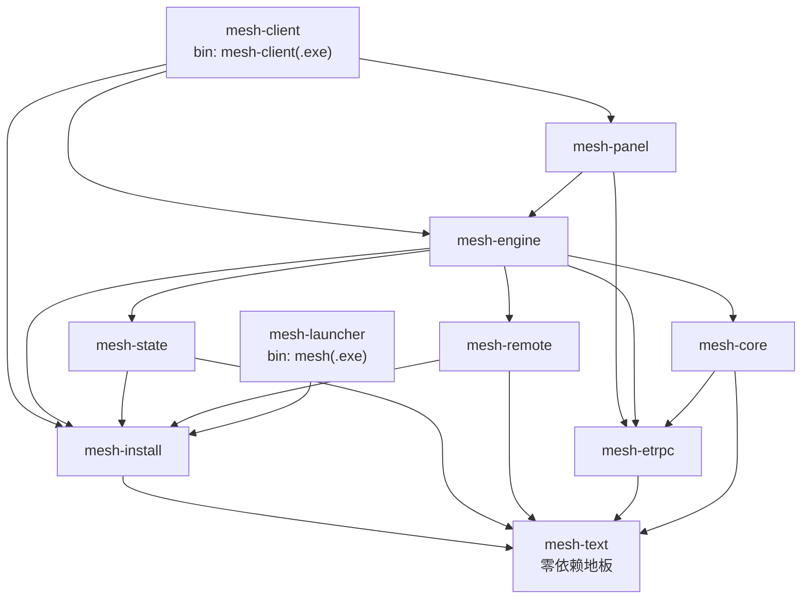

# 模块划分（cargo workspace）

十个成员：八个库 crate、两个二进制，整个 workspace 就是 `client/`。

## 1. 形状与依赖图

```
client/
  Cargo.toml            # [workspace] + [workspace.dependencies]
  .cargo/config.toml    # musl 目标用 musl-gcc
  frontend/             # pnpm + Vue 3 的面板前端，dist 在编译期嵌进 panel
  crates/
    text/               # mesh-text      语言清单、get/format、id 常量（唯一零依赖地板）
    install/            # mesh-install   安装根形状、版本、失败计数、清单与签名、两个锁、平台名
    state/              # mesh-state     config/ 下的身份与配置（含 config.toml 提示字段）
    remote/             # mesh-remote    设备面 HTTP + 签名
    etrpc/              # mesh-etrpc     core rpc portal：帧 + 手写 protobuf + 三个查询
    core/               # mesh-core      easytier-core 子进程托管（Job、输出泵、就绪探测）
    engine/             # mesh-engine    状态机（唯一可变状态的拥有者）
    panel/              # mesh-panel     本地面板 HTTP + 嵌入前端
    client/             # mesh-client    bin mesh-client(.exe)：进程形态、托盘、headless
    launcher/           # mesh-launcher  bin mesh(.exe)：槽位安装、启动确认、常驻监督
```



图上只画已经接上的边；`mesh-text` 对每个 crate 都是允许的（见第 2 节）。

## 2. 依赖方向（硬规则）

除 `mesh-text` 以外，允许的边只有上图那几条，其余一律禁止：

- `mesh-text` 是唯一零依赖的地板；`mesh-install` 只依赖它。
- 其余九个成员都可以依赖 `mesh-text`（文案从语言清单取），`mesh-text` 不依赖任何人。
- `mesh-state` / `mesh-remote` / `mesh-etrpc` / `mesh-core` 是叶子能力，**不得**依赖 `mesh-engine`、`mesh-panel`、`mesh-client`。
- `mesh-engine` 不得依赖 `mesh-panel`、`mesh-client`（引擎不知道面板与进程形态存在，退出通过注入的 `Shutdown` 句柄）。
- `mesh-panel` 不得依赖 `mesh-client`；`mesh-client` 是唯一知道「线程怎么排、托盘在哪」的地方。
- `mesh-state` 与 `mesh-remote` 之间不互相依赖（密钥由引擎从 `state` 取出后传给 `remote`）。
- 禁止出现 `common`/`util`/`types` 之类的筐。

## 3. 逐个 crate

### 3.0 `mesh-text`

**职责**：文案。`lang/chinese.lang` 与 `lang/english.lang` 是全部用户可见文本（含日志与错误说明）的唯一来源，代码里只引用 `id` 常量。规范见 [../docs/i18n.md](../docs/i18n.md)。

**对外 API**：

```rust
pub fn get(id: &'static str) -> &'static str;                      // 查不到原样返回 id，不 panic
pub fn format(id: &'static str, args: &[&dyn Display]) -> String;  // 替换 {0}、{1}……
pub mod id { pub const STATE_ERROR_IO: &str = "state.error.io"; /* …… */ }
```

**拥有的状态**：首次调用时装载一次的只读表（`OnceLock<HashMap<&'static str, &'static str>>`）。当前只装载中文；英文清单已嵌入并参与测试，不参与运行。

**依赖**：无。它是整个 workspace 的地板，`mesh-install` 只依赖它。

### 3.1 `mesh-install`

**职责**：安装根目录的磁盘事实。两个二进制都要用：布局与路径常量、版本号比较、失败计数、清单解析与签名、两个锁，各自只有这一份实现。

**对外 API**：

```rust
pub mod layout {
    pub const BIN: &str = "bin";            // 槽的父目录；其余：SLOT_ALICE、SLOT_BOB、CURRENT、
                                            //       UPDATE_FILE、FAILURES、LOCK、INSTALL_LOCK、
                                            //       LAUNCHER_VERSION、MANIFEST
    pub fn slot_name(name: &str) -> Option<&'static str>;   // 只做 ASCII 小写比较，认 alice / bob
    pub fn slot_dir(root: &Path, slot: &str) -> PathBuf;     // <root>/bin/<槽>
    pub fn read_current(root: &Path) -> Option<&'static str>; // trim 后只认规范槽名
    pub fn write_current(root: &Path, slot: &str) -> io::Result<()>; // 临时文件 + 改名，幂等
    pub fn find_root(exe: &Path) -> PathBuf;              // 主程序在 <root>/bin/<槽> 里，根是往上三级
    pub fn read_version(slot_dir: &Path) -> Result<String, Error>; // 读这个槽自己的 version.json
    pub fn write_launcher_version(root: &Path, v: &str) -> io::Result<()>;  // launcher.json
    pub fn read_launcher_version(root: &Path) -> Option<String>;            // 缺失或坏掉都是 None
}
pub mod version { pub fn parse(text: &str) -> Option<Version>; pub fn valid(text: &str) -> bool;  // YYYY.MM.DD-N
                 pub fn compare(a: &str, b: &str) -> Ordering; pub fn is_newer(candidate: &str, current: &str) -> bool; }
pub mod failures { pub struct Failures; /* load/record/clear/count/exhausted，留下最新 5 个版本 */ }
pub mod lock {
    pub struct Lock;                                          // 进程退出即释放（LockFileEx / flock）
    pub fn acquire(path: &Path) -> Result<Lock, Error>;       // 已被占用 → Error::AlreadyRunning
    pub fn path(root: &Path) -> PathBuf;                      // instance.lock：这份 config 的客户端
    pub fn owner_path(root: &Path) -> PathBuf;                // install.lock：安装根的写权
}
pub mod platform { pub fn client_exe() -> &'static str; pub fn launcher_name() -> &'static str;
                   pub fn core_name() -> &'static str; pub fn id() -> &'static str; } // "windows/amd64"
pub mod manifest { pub struct Manifest { version, slot, platform, files, signature }
                   pub fn read(path: &Path) -> Result<Manifest, Error>;   // 字段缺一即解析失败
                   pub fn parse(text: &str) -> Result<Manifest, String>;
                   pub fn is_plain_file_name(name: &str) -> bool; }       // 清单键与包内条目名同一判据
pub mod signing {
    pub const RELEASE_PUBLIC_KEY: &str;
    pub fn signing_string(slot, platform, version, sha256) -> String;      // MESH3，签包
    pub fn manifest_string(slot, platform, version, files_digest) -> String; // MESH4，签清单
    pub fn files_digest(files: &BTreeMap<String, String>) -> String;
    pub fn verify_release(..) -> bool;   pub fn verify_release_with(public_hex, ..) -> bool;
    pub fn verify_manifest(..) -> bool;  pub fn verify_manifest_with(public_hex, ..) -> bool;
}
pub fn atomic_replace(path: &Path, bytes: &[u8], perm: u32) -> io::Result<()>;  // 写临时文件再 rename；
// 只 flush 不 fsync，所以只承诺「进程中断可恢复」（见 ../docs/contract/updates.md「持久性」）
```

**拥有的状态**：无内存状态。`Failures` 是 `.update-failures.json` 的读写视图；`Lock` 是 OS 锁句柄（进程退出即释放），锁哪个文件由调用方给——客户端用 `Lock::path`（`instance.lock`），启动器与客户端提交安装包用 `Lock::owner_path`（`install.lock`）。

**依赖**：`mesh-text`（文案）；`fs4` 覆盖两个平台的锁（Windows 的 `LockFileEx`、Unix 的 `flock`）；`serde`/`serde_json` 给清单与 `launcher.json`；`ed25519-dalek` 与 `sha2`/`hex` 只给 `signing` 用。

**签名为什么在这里**：启动器要验清单签名，而它不能依赖 `mesh-remote`——那条线会把 `ureq`、`serde`、`rand`、`httpdate` 全拖进一个只需要 verifier 的二进制。签名字符串的形状与 Go 侧 `signing` 包逐字节相同，有一对固定向量单测钉住两端。

**注**：`read_version` 与 `Failures` 必须同时被客户端与启动器使用——「不比当前新不装」和「同版本失败两次就停手」在两侧都要判，重复实现迟早会分叉。

### 3.2 `mesh-state`

**职责**：`config/` 下的身份与配置。是这几件事的唯一入口：`client.json`、`client.key`（Ed25519 seed，缺失即生成、0600）、`secure.key`、`credential.json`、`config.toml`（字节 + 提示字段）。

**对外 API**：

```rust
pub struct Store { /* root, key 缓存, secure_key 缓存 */ }
pub struct ClientConfig { server_url, device_id, hostname, created_at }   // snake_case
pub struct Credential { id, secret, expires_at }
pub struct ConfigHints { hostname, ipv4, network_name, network_secret, encryption }
impl ConfigHints { pub fn formal(&self) -> bool; }   // network_secret 非空 == 正式节点

impl Store {
    pub fn open(root: &Path) -> Result<Store, Error>;
    pub fn load_client(&self) -> Result<Option<ClientConfig>, Error>;
    pub fn save_client(&self, c: &ClientConfig) -> Result<(), Error>;
    pub fn clear_device(&self) -> Result<(), Error>;
    pub fn signing_key(&self) -> Result<SigningKey, Error>;  // 读不到就生成一次
    pub fn secure_key(&self) -> Result<String, Error>;       // base64 的 32 字节
    pub fn load_credential(&self) -> Result<Option<Credential>, Error>;
    pub fn save_credential(&self, c: &Credential) -> Result<(), Error>;
    pub fn remove_credential(&self) -> Result<(), Error>;
    pub fn read_config(&self) -> Result<Option<String>, Error>;
    pub fn write_config(&self, toml: &str) -> Result<(), Error>;   // 临时文件 + rename
    pub fn config_path(&self) -> &Path;
}
pub fn parse_hints(toml: &str) -> ConfigHints;   // 解析失败给零值，不影响启动
```

**拥有的状态**：`signing_key` 与 `secure_key` 的内存缓存（各一把 `Mutex`）。只有它们需要缓存，因为「读不到就生成」必须是原子的——两个线程同时走到生成分支会互相覆盖。其余一律每次读文件，磁盘是唯一事实来源。

**依赖**：`mesh-install`（`atomic_replace`）。

### 3.3 `mesh-remote`

**职责**：设备面 HTTP。`/api/v1/register`、`/api/v1/heartbeat` 的组装与 Ed25519 签名、响应结构、错误码与 `Date` 头偏差、整包下载（带上限），以及发布包的签名验证。不知道磁盘布局，也不持有身份。

**对外 API**：

```rust
pub struct Client { /* base_url, device_id, key, agent（带超时） */ }
impl Client {
    pub fn new(base_url: &str, device_id: &str, key: SigningKey) -> Client;
    pub fn register(&self, token: &str, hostname: &str, pubkey_b64: &str, timeout: Duration)
        -> Result<RegisterReply, Error>;
    pub fn heartbeat(&self, config_hash: &str, app_version: &str, credential_id: &str,
                     timeout: Duration)
        -> Result<Option<Heartbeat>, Error>;  // None == 204
    pub fn download(&self, url: &str, dst: &Path, limit: u64, timeout: Duration)
        -> Result<u64, Error>;
}
pub enum Error {
    Unauthorized { code: String, server_time: Option<SystemTime> },  // 引擎按 code/偏差分支
    Api { status: u16, code: String, message: String },
    Transport(...), Decode(...),
}
pub struct Heartbeat { config_hash, config_b64, app_update, launcher, credential, credential_id, credential_expiry }
```

**拥有的状态**：无。签名原文（`MESH2\n<method>\n<path>\n...`）在 `signing_string` 里现拼，字段顺序写死并有单测。

**发布签名**：`signing` 子模块只是 `pub use mesh_install::signing::*` 的转出口，实现在 `mesh-install`（启动器也要验）。引擎经 `remote::signing::*` 调，与搬家前同名。

**依赖**：`mesh-install`（`platform::id()`）。

### 3.4 `mesh-etrpc`

**职责**：core 的 rpc portal。裸 TCP 帧（4B 长度 + 16B 头 + protobuf 载荷）、手写 protobuf 字段读写、三个查询、分片重组、超时。这个 crate 是升级 EasyTier 时唯一要改的地方，所以字段号常量与 `client/internal/easytierrpc/wire.go` 保持逐条对应。

**对外 API**：

```rust
pub fn show_node_info(addr: SocketAddr, timeout: Duration) -> Result<NodeInfo, Error>;
pub fn list_peer(addr: SocketAddr, timeout: Duration) -> Result<Vec<Peer>, Error>;
pub fn list_route(addr: SocketAddr, timeout: Duration) -> Result<Vec<Route>, Error>;
pub fn free_loopback_addr() -> SocketAddr;   // 每代 core 换一个空闲端口（默认 15888 常被别人占用）
pub struct NodeInfo { peer_id, ipv4, hostname, inst_id, version, stun: StunInfo }
pub struct Peer { peer_id, conns: Vec<PeerConn> }        // Tunnels()/Latency() 是纯函数
pub struct Route { peer_id, ipv4, hostname, cost, next_hop, path_latency, nat_type, proxy_cidrs, version }
```

**拥有的状态**：只有 `transaction_id` 计数器（`AtomicI64`，从 1 自增）。每次查询一条短连接，不留长连接——留长连接要处理 core 重启后连接已死与分片按事务号归并，而查询是毫秒级。

**依赖**：无。

### 3.5 `mesh-core`

**职责**：`easytier-core` 子进程。定位（只认与主程序同目录的 `easytier-core`，结果固定为绝对路径）、启动（参数 + 环境变量）、逐行输出转交、软停/强杀、Windows Job 对象、就绪探测（`ShowNodeInfo` 轮询 500ms、上限 25s）、代次计数。

**对外 API**（只暴露一个线程的入口和一条命令通道）：

```rust
pub enum Cmd {
    Start(StartSpec),
    Stop { reply: Sender<Result<(), String>> },
}
pub struct StartSpec {
    pub core_path: PathBuf, pub config_path: PathBuf, pub rpc_addr: SocketAddr,
    pub hostname: String,
    pub identity: Identity,          // Formal { key } | Credential { id, secret }
}
pub enum Event {
    Started { gen: u64, pid: u32, node: NodeInfo },   // node 来自就绪探测
    StartFailed { gen: u64, reason: String },
    Exited { gen: u64, err: Option<String> },
}
pub fn spawn(events: Sender<Event>, on_line: impl Fn(&str) + Send + 'static) -> Sender<Cmd>;
```

**拥有的状态**：`Child` 句柄、pid、当前代次、rpc 地址、Job 句柄。**这些都不离开 core 线程。**

**依赖**：`mesh-etrpc`（就绪探测要 `NodeInfo`，避免两处定义）；`windows-sys`（Job）/`libc`（进程组信号）。

**注**：`--rpc-portal` 与 `--rpc-portal-whitelist` 的环境变量覆盖（`MESH_RPC_PORTAL`/`MESH_RPC_WHITELIST`）、`ET_LOCAL_PRIVATE_KEY`/`ET_CREDENTIAL` 走环境变量不进命令行——这些行为一条都不能改。

### 3.6 `mesh-engine`

**职责**：状态机，也是唯一可变状态的拥有者。内部按 Go 的拆法分模块：`state`（Status/identity/update/计数器）、`lifecycle`（连接循环、代次、退避）、`heartbeat`、`sync`、`core`（与 core 线程的协议）、`settings`、`update`、`views`（快照、日志视图）、`autostart`（`cfg(windows)`）、`log`（logbook）。

**对外 API**：

```rust
pub struct Config { pub root: PathBuf, pub self_version: String, pub hostname: String,
                    pub auto_update_disabled: bool }
pub fn spawn(cfg: Config, cell: Arc<StateCell>, notices: Sender<Notice>,
             shutdown: Arc<Shutdown>) -> Result<(Sender<Cmd>, JoinHandle<()>), StartupBlocked>;
pub struct StartupBlocked { pub report: String, pub reason: String }   // 安装目录检查拦下启动

pub enum Cmd {
    Heartbeat(Result<Option<Heartbeat>, remote::Error>),   // 心跳线程只负责取样，判断都在引擎
    Core(Event), Stun(StunInfo),
    Download { version: String, result: Result<PathBuf, String> },
    Settings(SettingsInput, Reply<Result<Snapshot, String>>),
    Reset(Reply<Result<Snapshot, String>>),
    SetAutostart(bool, Reply<Result<Snapshot, String>>),
    ApplyUpdate(Reply<Result<(), String>>),
    Reconnect,
}
pub enum Notice { ActionFailed(String) }  // 用户动作失败 → client 弹一次框

// 发布给其它线程的只读视图。除快照外还带两样别的线程要用、但不该回问引擎的东西：
// 心跳线程组请求要的三个参数，以及面板自己查 core 时需要的 rpc 地址。
pub struct Published { snapshot: Snapshot, beat: BeatInput, rpc: Option<SocketAddr>, core_gen: u64 }
pub struct BeatInput { config_hash: String, credential_id: String, app_version: String }
pub struct StateCell(RwLock<Arc<Published>>);   // 面板与托盘同步只读它
pub fn logs(path: &Path, n: usize) -> Vec<Line>;      // 纯函数，读文件
pub fn events(path: &Path, n: usize) -> Vec<Line>;
```

**拥有的状态**：全部。`status`、`last_error`、`cfg`、`core_running`/`core_pid`/`core_cred_id`、`local_ip`、`stun`、`core_version`、`identity`、`update`（`UpdateState`：`offer`、`task`、`artifact`、`attempts`、`intent`）、`auth_fails`、`revive_attempt`/`core_started_at`、`autostart_on`、`launcher_sum`/`launcher_tried`/`auto_tried`。**没有一个被 `Mutex` 保护**，因为只有引擎线程读写；对外只发布只读副本（`Published`）。

`beat` 是心跳线程的输入：`config_hash` 现读现算（与 Go 相同，外部改坏 `config.toml` 也能被发现）、`credential_id` 取 `core_cred_id`、`app_version` 固定。**`credential_id` 只在引擎线程写**（写点是 `Cmd::Core(Started)` 与停止事件），心跳线程只读——这就是 F1 的修法，不能让别的线程绕过去。`rpc` 同理：`Some` 表示本代 core 在跑，面板据此决定要不要发查询，`None` 就返回空节点表（与 Go 的 `Dashboard` 在 core 未运行时直接返回一致）。`core_gen` 是引擎给每代 core 分配、只增的代次（`0` 表示还没有 core 进过），与 `rpc` 一起标识「哪个 core 实例」：重启后即使复用同一个回环端口，代次也不同。

**依赖**：`mesh-install`、`mesh-state`、`mesh-remote`、`mesh-core`、`mesh-etrpc`。

### 3.7 `mesh-panel`

**职责**：本地面板。回环监听（11020 起顺延 20 个）、`Host` 与同源 guard、静态资源与 SPA 兜底、11 个路由（10 个 `/api` + `GET /`）、把会改状态的方法转成 `Cmd` 并等回复、仪表盘的 core 查询（2s 缓存）与节点行拼装（`topology.rs`）、日志尾部读取。

**对外 API**：

```rust
// cell 提供快照（DTO）与 core 的 rpc 地址；tx 只用于会改状态的动作。
pub fn start(cell: Arc<StateCell>, tx: Sender<Cmd>, logs: PathBuf) -> Result<Panel, Error>;
pub struct Panel { pub url: String }   // 不持有 join handle：关闭就是关监听
```

**拥有的状态**：监听 socket、仪表盘查询缓存（`Mutex<Cache>`，条目是 `(Instance, Instant, Vec<Peer>, Vec<Route>)`，`Instance` 是 `(rpc 地址, core 代次)`）。除此之外什么都没有——面板不缓存快照，每次从 `StateCell` 取一个 `Arc`。查询结果只在仍属当前实例时写回：查询期间 core 换了代，这份数据既不写回也不覆盖新实例的缓存。

**依赖**：`mesh-engine`（DTO 与纯函数 `logs`/`events`）、`mesh-etrpc`（自己发起仪表盘查询与协议结构）。

**注**：JSON 的形状是前端契约的一部分，逐字段对照 `client/frontend/src/api/types.ts`。`publicIps` 必须是 `[]` 不是 `null`；`nodes` 是 `[]`（core 未运行）或 `null`（core 在跑但查询失败）或行数组，三态都要出现在类型里。`count` 为 1 时必须省略（Go 的 `omitempty`）。

### 3.8 `mesh-client`（bin）

**职责**：进程形态。参数解析、根目录、单实例锁、线程装配、退出顺序、桌面/headless 分支、托盘、浏览器与资源管理器、消息框、启动成功时提交 `bin/current`、headless 的日志跟随与控制台附着。

**模块**：`main`、`cli`（手写，风格同启动器 `args.rs`）、`instance`（锁与「唤起已有实例」）、`shutdown`（唯一的退出路径）、`commit`（启动成功后提交 `bin/current`）、`desktop`（托盘 + 主线程消息泵）、`tray`（Win32）、`headless`、`browser`（COM）、`opendir`、`notify`、`follow_log`。

**拥有的状态**：`Shutdown`（`Once`，幂等：停面板 → 停 core → 关日志 → `process::exit`）、托盘模型（`Arc<Mutex<TrayModel>>`，只有地址/自启勾选/更新行三项）、启动参数。

**依赖**：`mesh-install`、`mesh-engine`、`mesh-panel`、`windows-sys`+`windows`（COM）、`signal-hook`（Unix）。

### 3.9 `mesh-launcher`（bin `mesh`）

**职责**：安装根的写者。两条命令：不带安装参数是 `Launch`（拉起 `bin/current` 选中的槽），带 `--file`/`--url` 是 `Install`（装进候选槽）。改动安装根的动作全部在 `Owner` 之内：确认成功后删旧槽（选槽时不删任何槽）、解包、校验、拉起、等 `current` 确认。启动器从不提交 `bin/current`，只在它缺失、非法或指向无效槽时补写一次。

**对外 API**：

```rust
// args：--root 可覆盖安装根；--file 与 --url 互斥；--sha256/--wait-for/--force 只能配安装
pub enum Command { Launch, Install { source: Source, sha256: Option<String>,
                                     wait_for: Option<u32>, force: bool } }

// install.rs：安装根写权与一次安装
pub(crate) fn own(root: &Path) -> Result<Owner, String>;            // install.lock，非阻塞
impl Owner {
    pub(crate) fn recover(&self) -> Result<(), String>;             // 按 current 与槽的有效性决定启动哪一份
    pub(crate) fn abort(&self) -> Result<(), String>;               // 放弃未确认的安装：停候选槽，保留 current 与候选槽
    pub(crate) fn commit(&self) -> Result<(), String>;              // 收尾：删本次待装包
    pub(crate) fn install(&self, pkg: &Path, force: bool) -> Result<(), String>;  // 清空候选槽、解包、校验
    pub(crate) fn verify_current(&self) -> Result<(), String>;      // 校验某槽与清单同一集合
    pub(crate) fn boot_and_settle(&self) -> Result<launch::Client, String>;  // 拉起选中的槽，等 current 变成它
}
pub fn run(root: &Path, source: Source, want_sha: Option<String>,
           wait_for: Option<u32>, force: bool) -> Result<(), String>;  // 手动安装入口

// launch.rs：客户端子进程句柄
pub struct Client;
impl Client {
    pub fn exited(&mut self) -> Result<Option<i32>, String>;
    pub fn stop(&mut self) -> Result<(), String>;                   // 返回前确认它已退出
    #[cfg(unix)] pub fn wait(&mut self) -> Result<i32, String>;
}
pub fn start(exe: &Path, root: &Path) -> Result<Client, String>;   // 拉起槽内主程序，确认由观察 current 完成
pub fn wait_exit(pid: u32, timeout: Duration) -> Result<(), String>;  // 只给 --wait-for

#[cfg(windows)] pub(crate) fn launch_installed(root: &Path) -> Result<(), String>;
pub mod supervisor { #[cfg(unix)] pub fn run(root: &Path) -> Result<i32, String>; }   // Linux 常驻
```

**一次安装的产物与判据**：

| 产物 | 是什么 | 判据作用 |
| --- | --- | --- |
| `bin/current` | 一行槽名 | **唯一持久安装状态**；文件不在 == 还没提交过 |
| `bin/<槽>/version.json` | 该槽的版本清单 | 槽是否有效只看它：验签、槽位、平台、文件集合 |
| `bin/<槽>/` | 一个槽 | 当前槽或候选槽；候选槽没有有效清单就是半包 |
| `update.tar.zst` | 客户端交接的「请安装」信号（`.part` 是下载中） | 不是判据：只由消耗它的安装事务删掉 |

一次安装按下列顺序推进：

1. 验包根 `version.json` 的签名，确认它是客户端槽位、本机平台的。
2. 候选槽 = 非当前槽；清空候选槽。
3. 解包到候选槽，按最终落盘的内容校验该槽的 `version.json` 与文件集合。
4. 拉起候选槽的 `mesh-client`，等 `bin/current` 变成该槽名（60 秒）；没变或子进程退出即失败。
5. 成功：客户端已提交 `current`，随即删掉旧槽。
6. 失败：停掉候选槽；`current` 不动、候选槽保留；按版本记一次失败。

**四个入口、一个出口**：`boot_and_settle` 负责选槽、校验、拉起与等待 `current`——Windows 的安装后与普通启动（`run`、`launch_installed` → `boot_or_restore`）、确认被打断后的下一次启动、Linux 常驻监督（`supervisor::run`）。Linux 的手动安装同样拉起候选槽并等 `current`；确认失败就保留候选、不改 `current`。

| 结局 | 处理 |
| --- | --- |
| 验证不过、进程创建失败 | 记一次失败；`current` 不动，候选槽保留 |
| 确认超时或进程提前退出 | 先 `Client::stop` 并确认退出，再记一次失败；`current` 不动，候选槽保留 |
| `stop` 失败（停不下来） | 不动 `current`，保留候选槽，下一轮接着判 |
| 确认成功 | 清失败计数；删掉旧槽 |

**谁消费 `update.tar.zst`**：Linux 上只有常驻启动器每轮循环里的 `apply_pending`——读包里的版本，不比当前槽新、或清单读不出来都当场删掉，否则装它再删。Windows 上没有人按固定名去读：客户端把同一个路径作为 `--file` 交给启动器，由这次安装按 `downloaded` 判据处理——提交成功时 `commit` 删，安装失败时 `run` 删。客户端自己从不删固定路径上的这个文件。

**拥有的状态**：`Owner`（安装根路径 + `install.lock` 的锁句柄；当前槽每次从 `bin/current` 现读，不留内存副本）；`launch::Client`（客户端子进程句柄：Windows 是自己 `spawn` 的 `Child` 或 `runas` 交回的 `HANDLE`，Unix 是 `Child`）。除这些之外没有跨调用的内存状态：`Budget` 与命令参数都是值。

**依赖**：`mesh-install`（布局、清单、签名、失败计数、锁、版本比较）、`mesh-text`（文案）、`zstd`、`tar`、`sha2`；Windows 另加 `ureq`（`tls`+`native-certs`，`--url` 下载）与 `windows-sys`（`ShellExecuteExW` 的 runas、`TerminateProcess`、`WaitForSingleObject`）；Unix 的 `--url` 调系统 `curl`。

**注**：

1. Windows 拉起客户端要过 UAC：`CreateProcess` 返回 `ERROR_ELEVATION_REQUIRED(740)` 时改用 `ShellExecuteExW` 的 `runas`，并必须保留 `hProcess`——没有句柄就无从确认新版退没退，确认超时后不能安全换槽目录。
2. Windows 上安装失败后要自己把当前槽拉回来（`boot_or_restore` → `start_current`）：启动器装完就退，没有别人替它拉起。Linux 的常驻启动器回到循环开头重走一遍。
3. `verify_current` 要求槽目录与清单是同一个集合（`version.json` 除外）；装包、普通启动、手动安装后的拉起共用这一个判据。
4. 预算收在 `Budget::package`：1024 条目、64 KiB 清单、256 MiB 解压后、120 s；`--url` 另加 200 MiB 包与 300 s 下载。条目数与声明字节在读清单时判完（此时候选槽还没动），解包时同一组数字是兜底，触发即让候选槽停在无效状态。
5. 每次启动先把自身版本写进 `launcher.json`（编进二进制的 `MESH_LAUNCHER_BUILD_VERSION`；不是合法版本号的开发构建不写，客户端按「没有记录」放行一次）。日志写 `<root>/log/launcher.log` 并同时进 stderr；`Launch` 在 Linux 上把客户端的退出码透传给 systemd。

## 4. Go ↔ Rust 对应与状态归属

| crate | 对应 Go 包 | 拥有的状态 |
|---|---|---|
| `mesh-text` | —（Go 侧后续按同一格式实现） | 首次调用装载的只读表 |
| `mesh-install` | `internal/layout`、`internal/lockfile`、`internal/platform`、`internal/version` | 无（文件即事实） |
| `mesh-state` | `internal/state`、`engine/toml.go` | `client.key` / `secure.key` 的内存缓存 |
| `mesh-remote` | `internal/remote` | 无 |
| `mesh-etrpc` | `internal/easytierrpc` | `transaction_id` 计数器 |
| `mesh-core` | `internal/coreproc`、`engine/core.go` 的进程部分、`engine/waitReady` | core 子进程句柄、pid、代次、Job |
| `mesh-engine` | `internal/engine`（除 core 进程部分）、`internal/logbook`、`internal/autostart`、`internal/buildinfo` 的消费方 | 全部运行状态 |
| `mesh-panel` | `internal/uits`、`web.go` | 监听 socket、仪表盘缓存 |
| `mesh-client` | `main.go`、`internal/tray`、`notify/console/opendir` 平台文件 | `Shutdown`、托盘模型 |
| `mesh-launcher` | `client-launcher/` | `Owner` 的 `install.lock` 句柄；`launch::Client` 的客户端子进程句柄 |

## 5. 并发模型

### 5.1 线程一览

| 线程 | 数量 | 阻塞在 | 发消息给 |
|---|---|---|---|
| 主线程（Windows 桌面） | 1 | `GetMessageW` 消息泵 | 托盘动作线程（channel） |
| 引擎 | 1 | `inbox.recv()` | 面板回复（oneshot）、`StateCell`、`Notice` |
| core 托管 | 1 | `inbox.recv_timeout(100ms)` | 引擎（`Event`） |
| core 输出泵 | 2 | 管道读取 | 日志（直接写，见 5.4） |
| 心跳 | 1 | ticker + HTTP（≤20s） | 引擎（`Cmd::Heartbeat`）；请求参数先从 `StateCell` 读 |
| STUN 刷新 | 1 | ticker 20s + TCP（≤3s） | 引擎（`Cmd::Stun`） |
| 下载 | 按需 | HTTP（≤20 分钟） | 引擎（`Cmd::Download`） |
| 面板 HTTP | 4（线程池） | accept / 请求 | 引擎（`Cmd` + 回复） |
| 托盘动作 | 1 | channel | 引擎（`Cmd` + 回复），失败时 `MessageBoxW` |
| 信号（Linux） | 1 | `signal_hook` 迭代器 | `Shutdown` |

没有异步运行时，没有 `select!`：**每个 actor 一个入队点**，多路等待就变成「一个 channel + 消息枚举」。

Linux headless 上主线程不跑消息泵，只等退出（SIGTERM 或 `/api/quit` 触发 `Shutdown`）；引擎、core、面板线程与桌面形态相同，所以两个平台的线程模型只有主线程一处不同。

### 5.2 谁持有 core 子进程句柄

只有 core 托管线程。`Child`、pid、Job 句柄都不离开它；其他线程只能通过 `Sender<Cmd>` 提要求、通过 `Event` 收结果。理由：

- Job 对象与 `Child` 的所有权本来不可共享；Go 版里 `coreproc.Manager` 用一把 `mu` 在多个 goroutine 之间共享 `cmd`，是 `coreMu`/`coreGen` 之外第二层容易出错的锁。
- 停止需要「先礼后兵」（软停 → 5s → 强杀）并等待退出，只有一个线程做这件事时不需要额外的互斥。

core 线程的主循环用 `recv_timeout(100ms)`：既能处理命令，又能每 100ms `try_wait()` 回收子进程。代价是退出检测延迟 ≤100ms，相对 1s 起步的重拉退避可以忽略。

### 5.3 串行化点

1. **core 启停**：core 线程的命令队列（对应 Go 的 `coreMu`）。配置同步与崩溃重拉都往这里排队，不会再出现「两个 core 抢同一个虚拟 IP」。
2. **配置应用**：引擎线程一次只处理一条消息，所以「停 core → 写 TOML → 起 core」不会被另一条配置消息插进来（对应 Go 的 `updateMu`，但它消失了）。
3. **心跳节奏**：心跳线程一轮结束才等下一 tick，两轮不会并行（对应 Go 的 `heartbeatLoop`）。
4. **凭据上报**：`core_cred_id` 只在引擎线程写，写点是 `Cmd::Core(Started{..})` 与停止事件；心跳消息到达时读它。这是 F1（先报新凭据导致控制面吊销正在用的旧凭据）的修法，位置必须保持。
5. **更新**：`phase`（`Idle`/`Downloading`/`Ready`/`Failed`）由引擎独占；下载线程只回报 `Download` 消息。Go 的 `busy` 标志因此可以去掉，「下载中不覆盖」的判断改看 `phase`。
6. **跨进程**：两个文件锁，见 5.7。线程之间没有别的锁。

### 5.4 共享内存只剩两处

- `StateCell`（`RwLock<Arc<Published>>`）：引擎每处理完一条消息换一次 `Arc`，面板与托盘同步线程只读。**这是唯一的跨线程共享可变状态。** 面板一次请求只 `clone()` 一个 `Arc`，不复制快照；`config_hash` 在引擎发布时现读现算（与 Go 相同：外部改坏 `config.toml` 也能被发现），心跳线程读它组请求。
- 日志文件（`Mutex<File>` 在 `mesh-engine::log` 内）：core 输出泵与引擎都通过同一个 `Logger` 句柄写，与 Go 的 `logbook.Log` 一样用一把锁保护「按行追加 + 裁剪」。

引擎阻塞在 core 命令回复上（最长 25s）时，面板读的仍是上一份快照，不会挂——这是把快照从引擎里搬出去的唯一原因。

### 5.5 托盘：UI 线程与后端

```
  主线程（Win32 消息泵）                     引擎线程
   隐藏窗口 + Shell_NotifyIconW               StateCell 写入
   WM_COMMAND  →  菜单 id                       ↑
        │                                       │
        └──► mpsc<MenuId> ──► 托盘动作线程 ──► Cmd(带 oneshot 回复)
                                  │            │
                                  └── 失败时 MessageBoxW

   收到 WM_APP_SYNC ──► 按 TrayModel 刷菜单 ◄── Arc<Mutex<TrayModel>> + PostMessageW
```

- **托盘 → 后端**：`mpsc::Sender<MenuId>` 给「托盘动作线程」（普通线程，不在消息泵里）。它可以同步等引擎的 oneshot 回复并在失败时弹框——等价于 Go 里 systray 的 `ClickedCh` + 回调 goroutine。菜单本身不等待任何结果。
- **后端 → 托盘**：`Arc<Mutex<TrayModel>>` 存「想让菜单长什么样」，再用 `PostMessageW(WM_APP_SYNC)` 叫醒消息泵去刷。发送方永不阻塞；同一状态反复投递只是多刷一次。
- **为什么不能反过来**：菜单文字必须在创建它的线程上改，而那个线程必须长期阻塞在 `GetMessageW` 里；引擎不能跑在它上面。
- **更新行**：`TrayModel.update` 是 `None` / `Downloading` / `Ready(version)`，对应 Go 里 `SetUpdate` 的隐藏/禁用/可点三态。
- **自启勾选失败的回弹**：引擎把系统真实状态写回快照，`TrayModel` 跟着变，勾选框自己弹回去（与 Go 的 `SetAutostart` 返回 false 时不动菜单等价），同时弹一次框。

### 5.6 退出只有一条路

`Shutdown`（`Arc`，`Once`）：停面板 → 停 core（core 线程 `Stop` 并等回复）→ 关日志 → `process::exit(code)`。

Go 里 `quit`（停资源 + 通知主循环）与 `stop`（只停资源）是两件事，历史原因是更新路径曾想 `exec` 自己；实际 `applyUnix` 是 `stopResources()` 之后 `quitApp()`，两者总是成对出现。Rust 合成为一个幂等入口，托盘退出、`/api/quit`、SIGTERM、更新交接都调它。

### 5.7 进程之间：两个锁

两个锁回答不同的问题，互不替代：

| 锁 | 回答的问题 | 谁持有 | 持有多久 |
|---|---|---|---|
| `instance.lock` | 这份 `config/` 是不是已经有一个客户端 | 客户端（`client::main` 取得后持有到进程结束） | 整个进程；启动器只在 `client_running` 里试拿一次就放开 |
| `install.lock` | 安装根现在是不是有人在改 | 启动器（`Owner`），以及客户端的两次写：提交更新包、替换启动器 | 一次事务（含等旧客户端退出、等启动确认）/ 一次写动作；Windows 一条命令一个，Linux 每轮循环一个 |

- `instance.lock` 只回答「有没有客户端在跑」。启动器拿它不是要占住，而是试一次：拿得到就是没人跑，立刻放开。崩溃由内核释放，不会留下要人工删的锁文件。
- `install.lock` 在 `own()` 里非阻塞地取；拿不到就报「安装根正被占用」，不排队。
- Linux 常驻启动器只在「`recover` → `apply_pending` → `boot_and_settle`」这一段持有它，`client.wait()` 等客户端期间放开——客户端提交更新包与替换启动器要用同一把锁，一直握着就永远提交不了。客户端拿不到只影响这一次提交：包留在 `.part`，下一轮心跳再试。
- 冲突不靠锁预防，而是入口前提：
  1. **Linux 上手工安装先停服务。** 客户端在跑时它占着 `instance.lock`，手工 `mesh --file` 会被 `client_running` 判据拒绝；`systemctl stop` 之后才能装。
  2. **Windows 上客户端在跑时，`--file` 必须带 `--wait-for <pid>`。** 启动器等它退出（上限 60 s）；没有这一项就直接拒绝，不在运行中的客户端脚下换 `bin/`。

## 6. 错误分层

| 层 | 错误类型 | 内容 |
|---|---|---|
| `mesh-install` | `Error { ManifestRead, Io, AlreadyRunning }` | 清单读不出来（版本号非法也归在这里）、普通 IO、锁被占。`AlreadyRunning` 必须独立成变体：上层要据此走「唤起已有实例」或「下一轮再提交」而不是报错 |
| `mesh-state` | `Error { Io, Parse, KeyLength }` | 文件读写与格式；`client.key` 长度异常直接失败，不重建 |
| `mesh-remote` | `Error { Unauthorized{code,server_time}, Api{status,code,message}, Transport, Decode }` | `Unauthorized` 带 `code` 与 `Date` 偏差，因为引擎要分三支：`revoked` / 时钟偏差 / 其它 |
| `mesh-etrpc` | `Error { Connect, Frame, Protocol{field}, Rpc(String), Timeout }` | `Rpc(String)` 已在 crate 内把 `error.Error` 的 oneof 翻成一句话 |
| `mesh-core` | 不出现在 API 上 | 失败一律折成 `Event::StartFailed{reason}` / `Exited{err}`：「core 起不来」对引擎是一个状态，不是一个要向上传播的错误 |
| `mesh-engine` | 后台路径不返回 `Result` | 失败写进 `status`/`last_error`（与 Go 的 `setStatus`/`degrade` 一致）；只有「用户动作」返回 `Result<Snapshot, String>` |
| `mesh-panel` | 不定义错误类型 | 直接把 `String` 写进 `{"error": ...}`，与 Go 的 `writeError` 相同 |
| `mesh-client` | `Result<(), String>` | 启动路径（锁、清单、面板监听）失败就报一句人能看懂的话，Windows 上再弹 `MessageBoxW`。与启动器的约定一致 |

**传播规则**：

1. 只在需要分支的地方匹配具体变体（401 的 `code`、`AlreadyRunning`、`errNoCredential` 的三态），其余在边界处 `map_err` 成一句话。
2. **禁止在库 crate 里用 `anyhow`**：它把「哪层出错」抹成字符串，而 401 分支正需要那个类型。
3. 不建公共 `AppError`、不跨层包 `Box<dyn Error>`：每层 `thiserror` 定义自己的枚举，`Display` 就是给面板与日志看的那句话。
4. 「预期内的可恢复失败」不算错误：core 反复起不来、心跳超时、配置同步失败都属于状态机要表达的状态，不是要冒泡的 `Err`。

## 7. 为什么这么切

**切分依据只有两条**：（a）这个模块是否被**两个以上**的消费者使用（`text`、`install`、`state`、`remote`、`etrpc`、`core`）；（b）这个模块是否有**独立的并发/线程故事**（`core` 独占子进程、`panel` 独占监听、`client` 独占托盘）。其余一律是 crate 内模块——Rust 的模块边界是免费的，Cargo 成员边界不是。

所以 `engine` 是一个大 crate 而不是三个：心跳、配置同步、core 启停共享同一份可变状态（`status`、`core_cred_id`、`identity`、`update`），拆开只能共享锁或再加一层消息转发。`logbook` 与 `autostart` 也是 crate 内模块，因为只有引擎与面板用，而面板经引擎拿日志。

### 放弃的替代切法

| 备选 | 为什么不 |
|---|---|
| 单个 crate + 模块（不分 workspace） | 没有编译期的方向约束，`engine` 会慢慢把面板、托盘都拖进来；启动器也没法复用 `install`。没有共享 crate 时，`version` 比较与失败计数只能每个二进制各写一份 |
| 按层切（domain / app / infra） | 每个概念只有一个实现，没有第二个实现也没有替换需求，纯增抽象层 |
| `engine` 拆成 `heartbeat`/`config`/`core-sync` 三个 crate | 三者共享同一份可变状态，拆开后只能靠共享锁或消息转发，比同 crate 内模块更差，且「谁拥有 status」变得说不清 |
| 面板独立进程 | 多一份生命周期、端口协商与失败模式；收益只有「面板崩了不影响网络」，而面板只是回环 HTTP 的 11 个 handler |
| 按平台切 crate（`mesh-win` / `mesh-linux`） | 90% 代码共享，`cfg` 会在 crate 边界上来回转发；改用 crate 内 `#[cfg]` 模块（Go 用 build tags 的地方），`cfg` 只出现在文件名/平台标识、托盘、Job 与停止、自启、退出握手五处 |
| 合并启动器与客户端成一个二进制 | 清单不同（`requireAdministrator` vs `asInvoker`）、IL 不同；Linux 上启动器必须在 `bin/` 损坏时还能跑；Windows 上启动器要在客户端退出之后继续工作 |
| 用 `tray-icon`/`tao` 起托盘 | 它们要的是「框架的事件循环」，会和「后端跑在线程里、主线程只跑消息泵」的模型互相让位；手写只多 400 行但顺序完全可控 |

## 8. `Cargo.toml` 草案

```toml
[workspace]
resolver = "2"
members = [
  "crates/text", "crates/install", "crates/state", "crates/remote",
  "crates/etrpc", "crates/core", "crates/engine", "crates/panel",
  "crates/client", "crates/launcher",
]

[workspace.package]
version = "0.1.0"
edition = "2021"
rust-version = "1.83"

[workspace.dependencies]
mesh-text    = { path = "crates/text" }
mesh-install = { path = "crates/install" }
mesh-state   = { path = "crates/state" }
mesh-remote  = { path = "crates/remote" }
mesh-etrpc   = { path = "crates/etrpc" }
mesh-core    = { path = "crates/core" }
mesh-engine  = { path = "crates/engine" }
mesh-panel   = { path = "crates/panel" }

serde      = { version = "1", features = ["derive"] }
serde_json = "1"
toml       = "0.8"
sha2       = "0.10"
hex        = "0.4"
base64     = "0.22"
ed25519-dalek = "2"
rand       = "0.8"
thiserror  = "1"
tiny_http  = "0.12"
include_dir = "0.7"
fs4        = "0.12"
ureq       = { version = "2", default-features = false }

[profile.release]
opt-level = "z"
lto = true
codegen-units = 1
panic = "abort"
strip = true
```

各成员依赖（`[target.'cfg(...)'.dependencies]` 省略不写，只标平台）：

| crate | 依赖 |
|---|---|
| `text` | 无（零依赖地板） |
| `install` | `mesh-text`、`fs4`（跨平台 `LockFileEx`/`flock`）、`serde`、`serde_json`、`thiserror`、`ed25519-dalek`、`hex`、`sha2`（后三只给 `signing`） |
| `state` | `mesh-install`、`mesh-text`、`serde`、`serde_json`、`toml`、`ed25519-dalek`、`rand`、`base64` |
| `remote` | `mesh-install`、`mesh-text`、`serde`、`serde_json`、`sha2`、`hex`、`base64`、`ed25519-dalek`、`rand`、`ureq`（windows 加 `native-tls`，unix 加 `tls`） |
| `etrpc` | `mesh-text`、`thiserror`（其余是 `std::net` + `std::io`） |
| `core` | `mesh-etrpc`、`mesh-text`、`thiserror`；windows: `windows-sys`（`Win32_Foundation`、`Win32_System_JobObjects`、`Win32_System_Threading`）；unix: `libc` |
| `engine` | `mesh-install`、`mesh-state`、`mesh-remote`、`mesh-core`、`mesh-etrpc`、`serde`、`serde_json`、`sha2`、`hex`、`thiserror`、`rand`；不需要 windows-sys（自启只写 UTF-16 文件 + 起 `schtasks.exe`，隐藏窗口用 `CommandExt::creation_flags`）；dev: `ed25519-dalek`（给测试 offer 签名） |
| `panel` | `mesh-engine`、`mesh-etrpc`、`tiny_http`、`include_dir`、`serde_json` |
| `client` | `mesh-install`、`mesh-engine`、`mesh-panel`；windows: `windows-sys`（`Win32_UI_Shell`、`Win32_UI_WindowsAndMessaging`、`Win32_Graphics_Gdi`、`Win32_System_LibraryLoader`、`Win32_System_Console`）+ `windows`（`Win32_UI_Shell` 的 `IShellDispatch`、`Win32_System_Com`）；unix: `signal-hook`；build: `winresource` |
| `launcher` | `mesh-install`、`mesh-text`、`zstd`、`tar`、`sha2`；windows: `ureq`（`tls`+`native-certs`，只开 `native-tls` 不会成为 `ureq` 的默认 provider）、`windows-sys`（`Win32_Foundation`、`Win32_System_Registry`、`Win32_System_Threading`、`Win32_UI_Shell`、`Win32_UI_WindowsAndMessaging`）、build: `winresource`；unix: 无（下载走系统 `curl`）；dev: `ed25519-dalek`（造签名正确的测试包） |

`crates/panel/src/assets.rs`：`include_dir!("../../frontend/dist")`——路径相对 crate 根（`client/crates/panel` → 仓库根），直接吃 `frontend/` 的构建产物，不复制、不改名。前端未构建时先跑占位脚本（等价 `wails3 task stub:frontend`），再编译。

## 9. 复核清单（历史故障点 → 新代码位置）

这些是过去几轮 review 修出来的行为，重写时逐条对照，缺一条都算回归：

| 故障点 | 现在的修法 | Rust 位置 |
|---|---|---|
| F1 凭据上报过早 | 报 core 实际加载的那张 | `engine::core`（`core_cred_id` 写点）与 `heartbeat` 的读取点 |
| F7 更新时进程先退出 | `stop` 与 `quit` 分离 | 合成后的 `Shutdown::run_and_exit`（更新交接必须先 spawn 启动器再退出） |
| core 主动停止被当成崩溃 | `coreGen` 在 `Stop` 之前递增 | `mesh-core` 的 `gen` 归 core 线程所有，`Event` 带 gen |
| 短命 core 把退避冲掉 | 每次尝试**之前**等退避 + `coreMinLifetime` | `engine::lifecycle` 的 `next_revive_attempt`/`wait_revive` |
| 「心跳→重连→心跳」零延迟回路 | 心跳循环不立刻 beat | `engine::heartbeat` 的 ticker 与 `core_running` 判断 |
| 自动更新反复重试同版本 | `auto_tried` / `launcher_tried` | `engine::update` |
| 失败态被下一轮心跳抹掉 | `phase == Failed` 且版本相同时不改写 | `engine::update::offer` |
| 401 一律清身份 | `revoked` / 时钟偏差 / 连续 3 次三支 | `engine::sync::handle_auth_rejected` |
| 日志被超长行卡死 | 4MiB 单行上限 + 继续排空管道 | `mesh-core` 的输出泵 |
| Windows 日志裁剪无法 rename | close → rename → reopen | `engine::log::rotate` |
