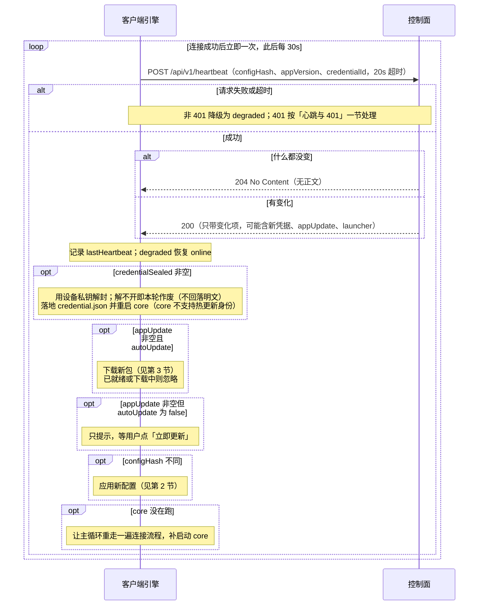
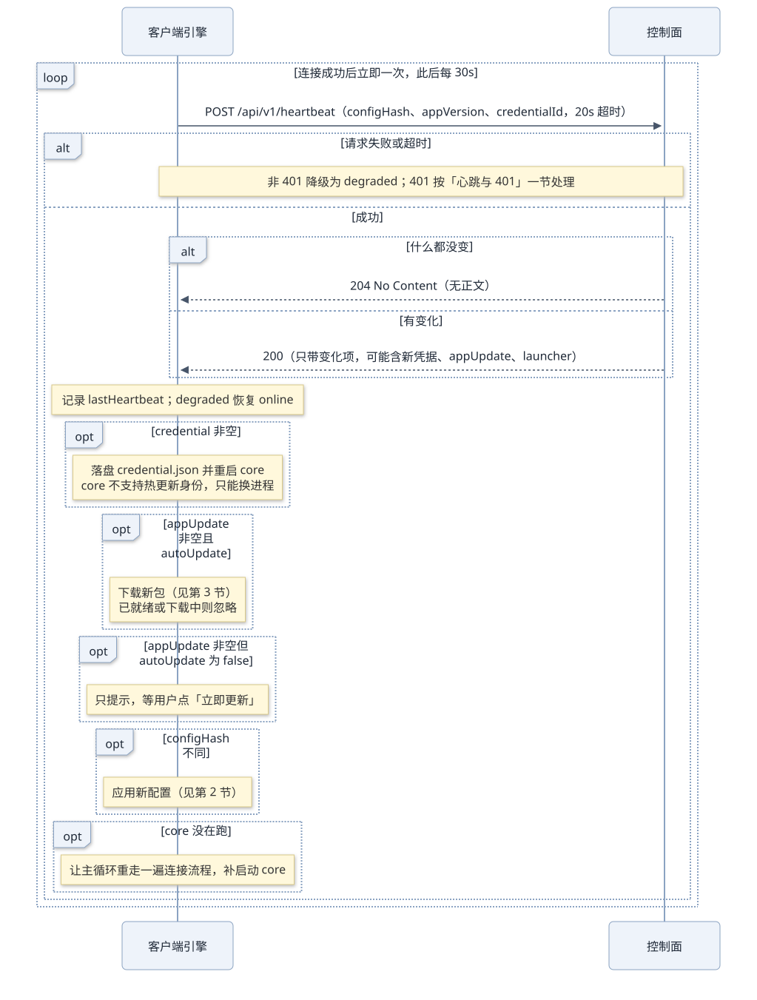
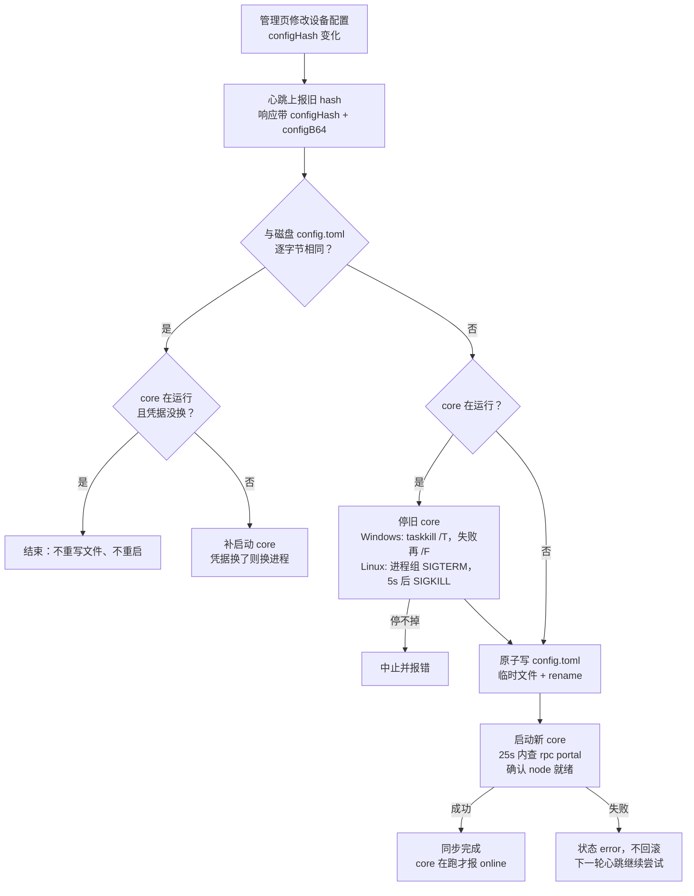
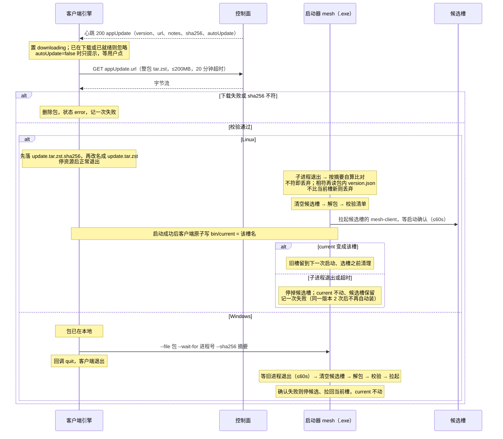
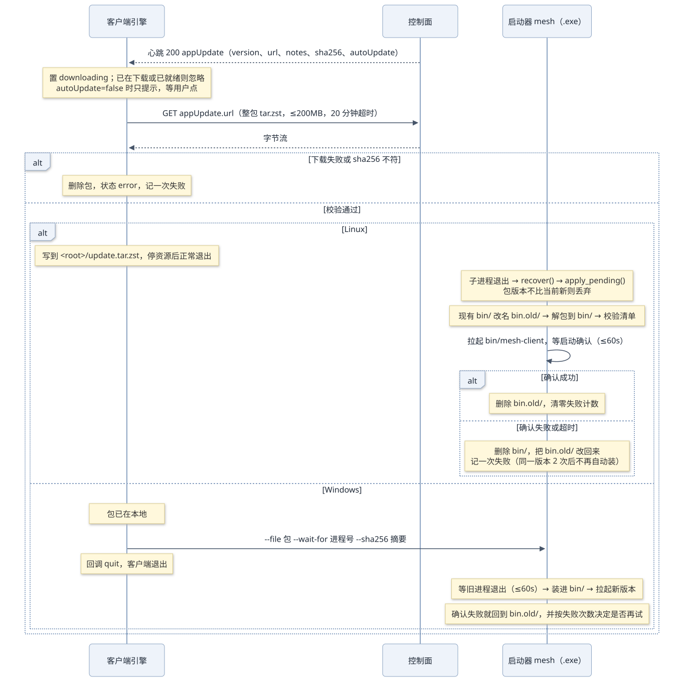
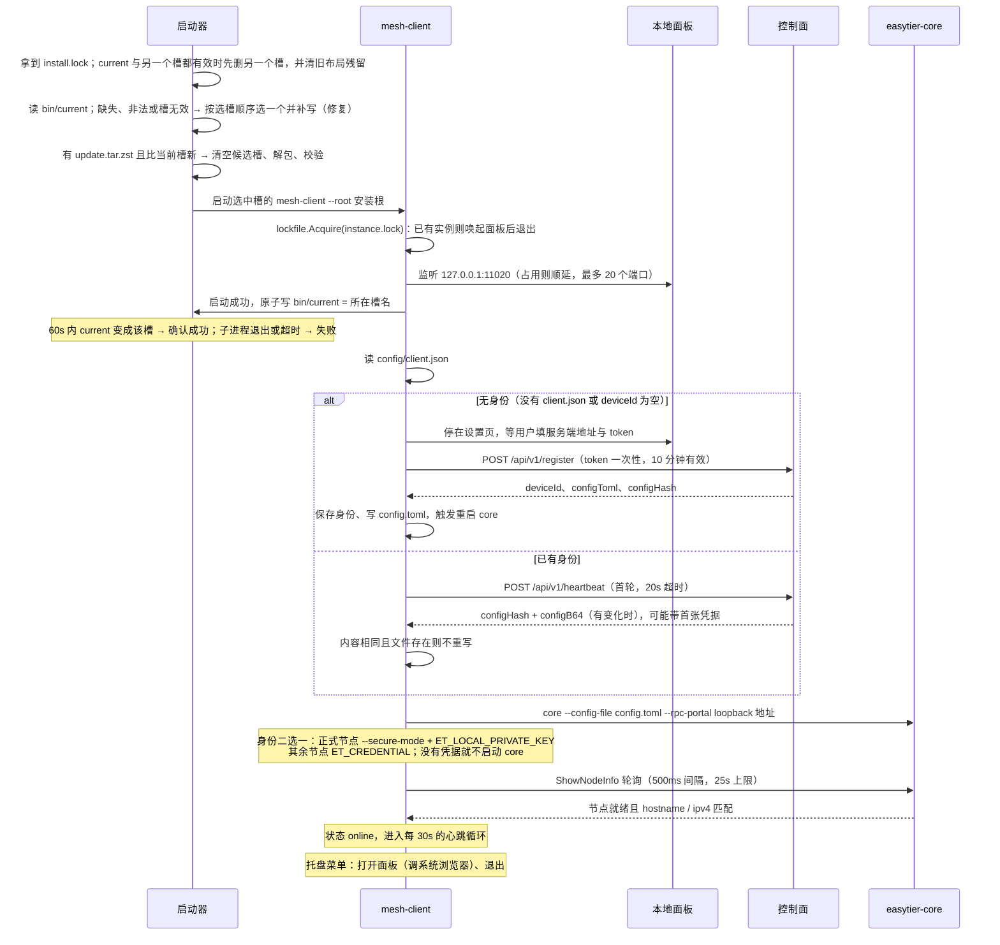
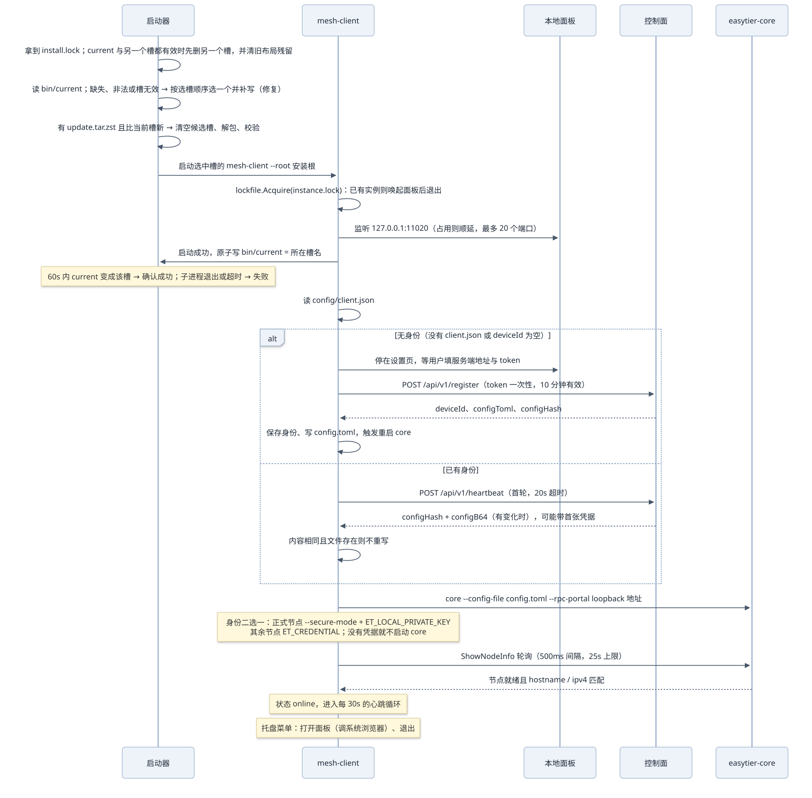
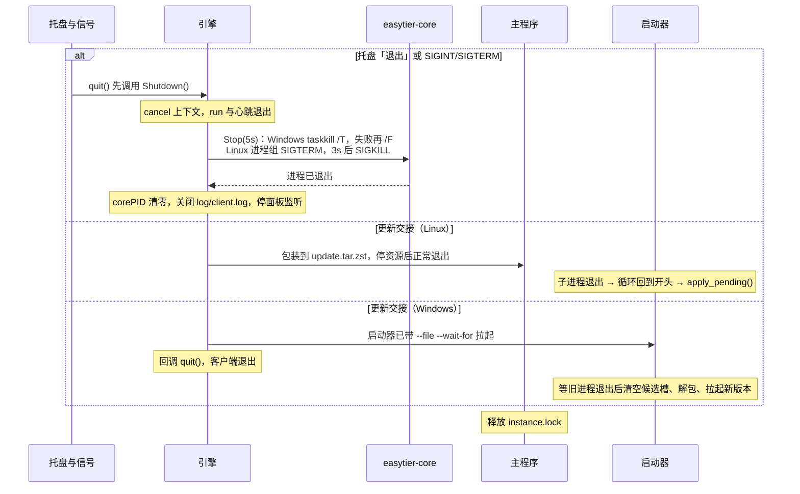
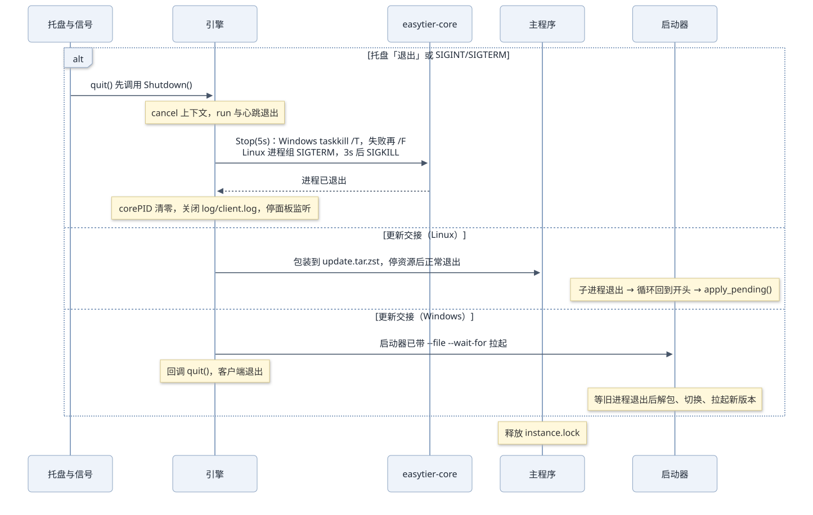

# 客户端流程图

依据 `client/`（Rust）的当前实现绘制：启动器在 `crates/launcher`，客户端在 `crates/client`。图中常量均取自代码：心跳 30s、请求超时 20s、core 就绪 25s、停止 core 5s、core 重拉退避 1s→30s、连接退避 10s→60s、面板端口 11020（最多顺延 20 个）、更新包下载 20 分钟、更新包上限 200MB、启动确认 60s、启动器等旧进程退出 60s。

安装目录布局、槽位与提交规则见 [contract/updates.md](../../docs/contract/updates.md)。

## 1. 心跳（heartbeat）

连接成功后立即发一次，此后每 30s 一次；响应只携带发生变化的内容，配置变化触发同步，`appUpdate` 触发后台下载。`credentialId` 报的是 core 实际加载的那张凭据，不是刚写进磁盘的那张——落盘到 core 重启之间还有一段时间，提前上报会让控制面吊销正在使用的那张。

## 2. 配置更新（config apply）

心跳报告 hash 与服务端不同才下发配置；与磁盘上的 `config.toml` 逐字节相同就不重写文件、也不重启 core——唯一例外是 core 手里的凭据已经不是本地那张：换凭据只能换进程。core 起不来不回滚，下一轮心跳继续尝试。

## 3. 应用更新（self update）

是否更新只看心跳里的 `appVersion` 与发布记录 `version` 的版本序（`YYYY.MM.DD-N`，按日期与当日序号数值比较）。`autoUpdate` 为 true 时客户端自己装，false 时只提示；同一版本连续失败 2 次后不再自动装。

客户端只负责下载与交接；解包进候选槽、校验、拉起、等确认由启动器做；提交 `bin/current` 由客户端在启动成功时做。两个平台的差别只在交接方式：

- **Linux**：客户端先把整包摘要写到 `<安装根>/update.tar.zst.sha256`，再把包改名成 `update.tar.zst`，然后正常退出。常驻启动器（systemd 的 `ExecStart`）看到子进程退出就回到循环开头：先按摘要自算比对，不符就丢弃包与摘要、不碰候选槽；相符再读包里的 `version.json`，不比当前槽新就丢弃，否则清空候选槽、解包、校验、拉起。确认以 `current` 变成该槽为准；旧槽不在确认那一瞬删，留到下一次启动、选槽之前清理。失败则停掉候选、`current` 不动。
- **Windows**：包已经在本地，客户端拉起 `mesh.exe --file <包> --wait-for <pid> --sha256 <摘要>` 后退出。启动器等旧进程退出（≤60s）、清空候选槽、解包、校验、拉起，等 `current` 变化；失败就停掉候选并把当前槽拉回来；旧槽同样留到下一次启动、选槽之前清理。

## 4. 应用启动（startup）

启动器只拉起 `bin/current` 选中的槽。槽名固定为 `alice`、`bob`，启动器与程序路径集合都不随版本变化，防火墙规则与服务配置只认这两条。选槽顺序：`current` 有效就用它；否则在有效槽里取目录名字典序最大的（`bob` 优先）；两个都无效即没有可启动版本。启动器从不提交，只在 `current` 缺失、非法或指向无效槽时补写一次（修复）。

客户端进程先取单实例锁，再读本地身份；没有身份时起本地面板等用户填地址与 token，有身份时打一次心跳取配置与凭据、起 core、等就绪后进入心跳循环。界面是浏览器里的面板（`127.0.0.1:11020`，被占用就顺延），启动时**不再自动打开浏览器**，托盘菜单里的「打开面板」才开。起 core 需要身份：正式节点用 `--secure-mode` 加 `ET_LOCAL_PRIVATE_KEY`，其余节点等控制面签发凭据、私钥走 `ET_CREDENTIAL`；两把私钥都不进命令行。没有凭据就先停在 `error` 并让心跳继续跑。启动成功（引擎与面板就位；桌面版还要求托盘起来）后，客户端若发现自身可执行文件的父目录是槽名，就原子写 `bin/current` = 该槽名；启动器在 60 秒内看到它即确认成功。

## 5. 应用退出（shutdown）

托盘「退出」、SIGINT/SIGTERM 与更新交接才真正结束进程：先停 core（Windows 走 `taskkill /T`，失败再 `/F`；Linux 先给进程组 `SIGTERM`，3 秒不退再 `SIGKILL`），再关日志与面板监听，最后释放单实例锁。

Linux 上客户端退出即「交接」：常驻启动器就是 systemd 的主进程，客户端只是它的子进程，退出不代表服务停止。Windows 上启动器在确认客户端起来之后就已经退出，客户端退出后需要用户再双击。

## 6. 心跳与 401

30s 一次 `POST /api/v1/heartbeat {deviceId, timestamp, nonce, platform, signature, configHash, appVersion, credentialId}`。`credentialId` 报本地正在用的那张：没有凭据报 `none`，正式节点报空串。

401 不「一律清身份」（服务端只在删除身份时回 `revoked`）：

- `code=revoked`：清本地 `device_id`、停 core、回设置页。
- 其它 401（`unauthorized`）：服务端不区分时钟偏差、nonce 冲突与签名错误，客户端用响应的 `Date` 头判断本机时间偏差。偏差超过 300 秒窗口时只降级并提示「请校准本机时间」，**不清身份**；没有明显偏差时，连续 3 次 401 才按身份失效处理。任何一次成功的心跳或连接都会清零计数。