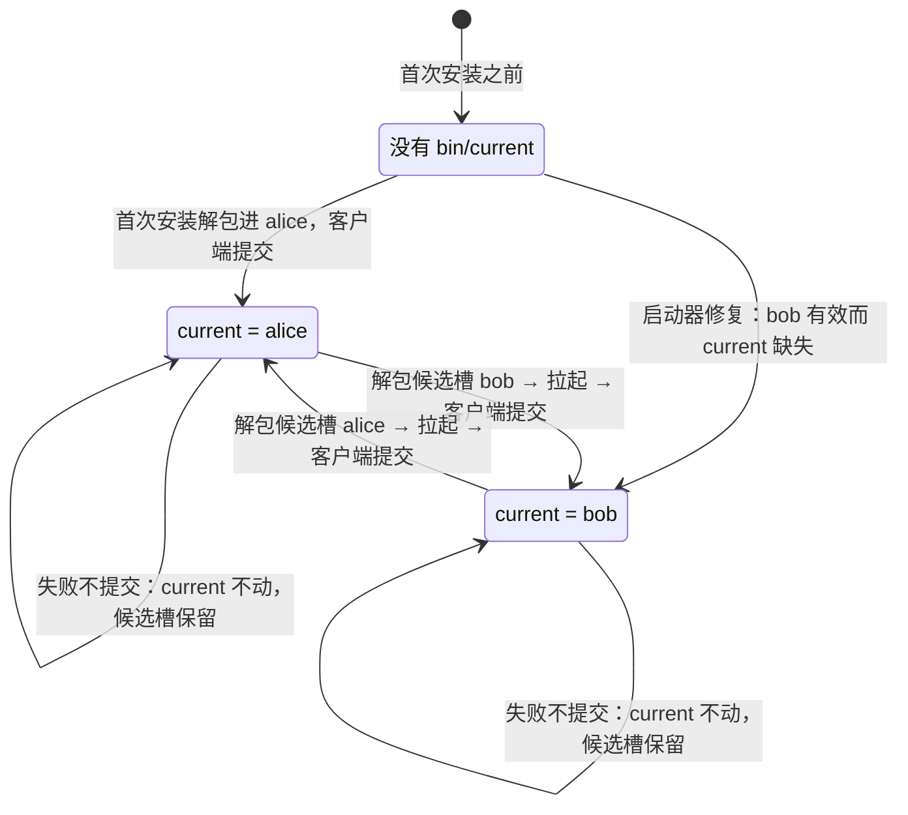
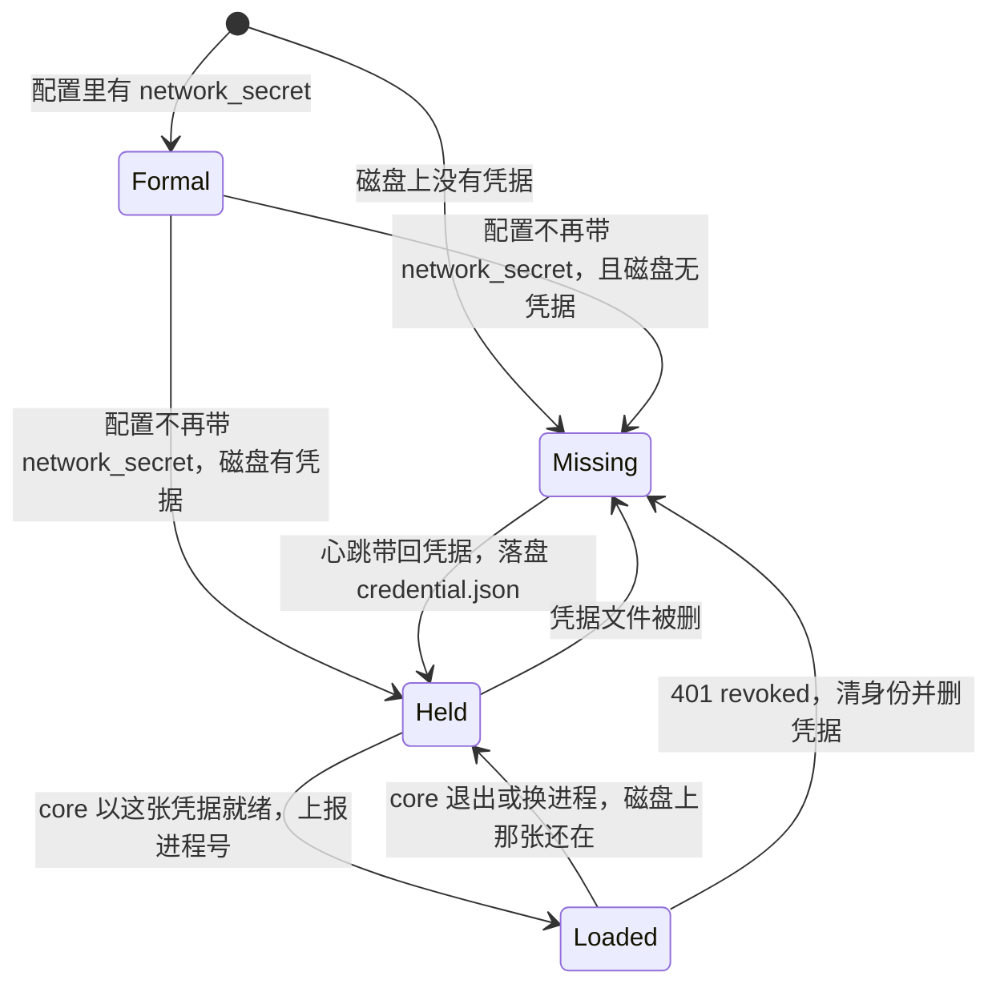
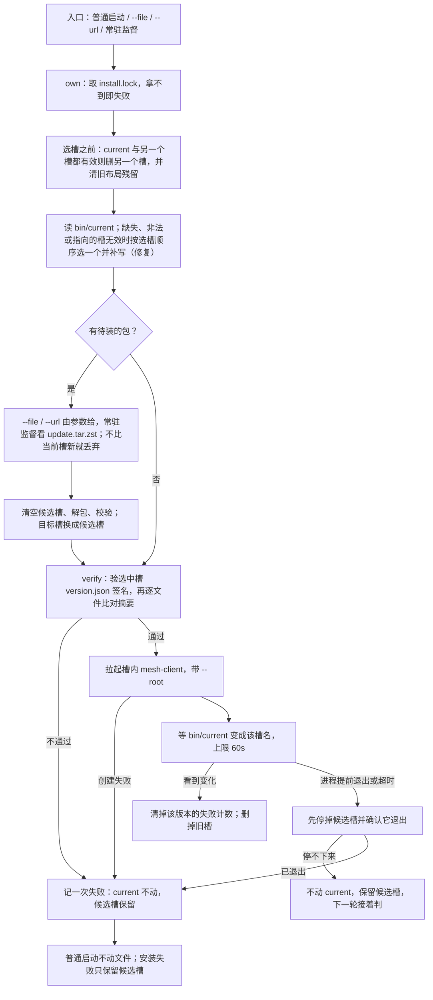
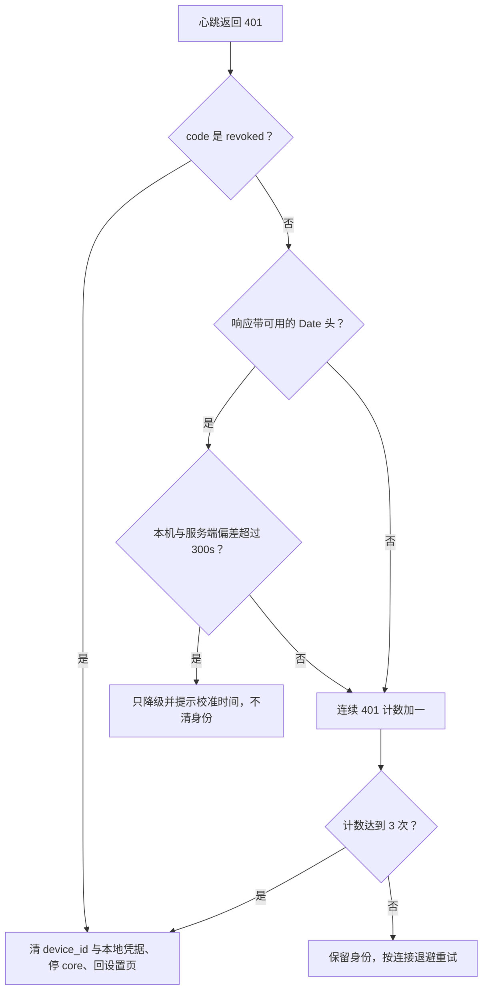
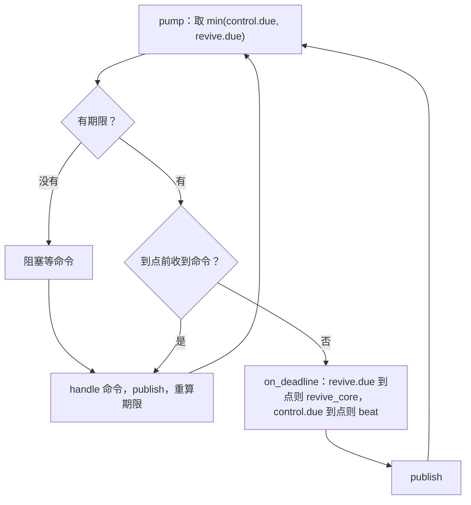
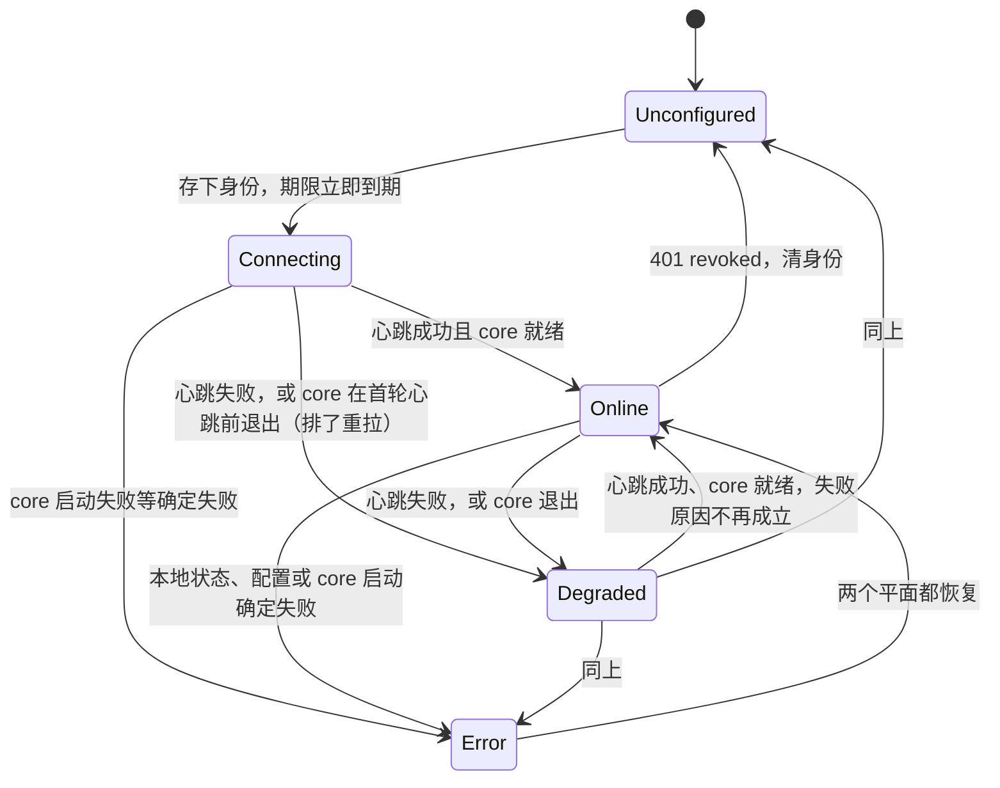
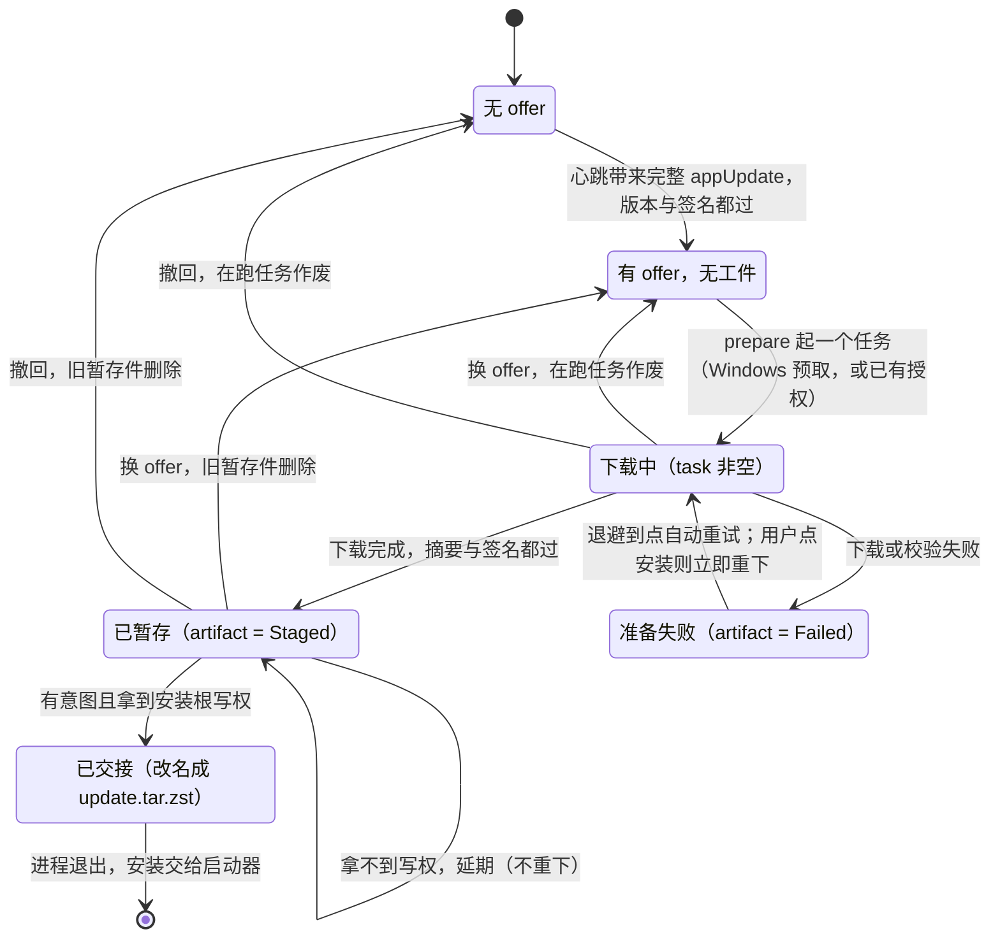
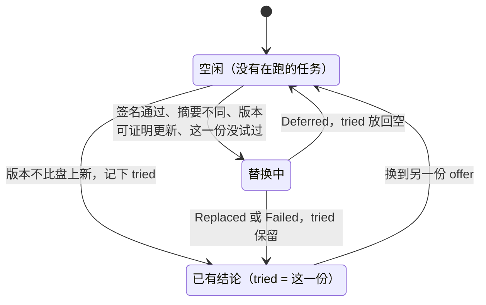

# 客户端状态模型

本文只写客户端的**状态空间**：有哪些状态、谁能进入、允许的迁移、跨状态必须成立的不变量。线格式与磁盘文件形状不在这里重复，见 [契约/updates.md](../../docs/contract/updates.md)（安装布局、槽位与提交）与 [契约/client.md](../../docs/contract/client.md)（本地状态、启动、凭据上报、401）。

本文覆盖六个模型：安装布局与当前槽、凭据身份、启动器监督与启动确认、连接失败与 401、引擎的期限模型与状态推导、更新（offer / 下载任务 / 工件 / 意图）与启动器替换。不覆盖：线格式与磁盘文件字段（见上述契约），以及面板与托盘的呈现细节。流程图与时序见 [flows.md](flows.md)。

## 1. 安装布局与当前槽

安装根的持久状态只剩 `bin/current` 一行：它指向 `alice` 或 `bob`，或者不存在。「不存在」是合法状态，只表示还没有提交过；安装是否完整由槽自己的 `version.json` 回答。

| 状态 | 什么使它成立 | 谁写 |
| --- | --- | --- |
| 没有该文件 | 还没有提交过；手工删掉也不视为损坏 | — |
| `alice` | `alice` 是有效槽，且被提交 | 客户端（启动成功且父目录是槽名）；启动器只在修复时 |
| `bob` | 同上 | 同上 |

规则：

1. `bin/current` 是唯一的持久安装状态。一行文本，值只能是两个槽名之一，首尾空白忽略。
2. 槽名固定为 `alice`、`bob`，永不含版本号：Windows 的防火墙与杀软规则按程序路径建立，路径集合必须恒定；历史教训是用日期命名槽位，规则只增不减。
3. 槽有效：`version.json` 验签通过（`MESH4`、`slot = client`、本机平台、文件集合与逐文件摘要），且目录里没有清单之外的文件。没有有效清单即半包。
4. 候选槽 = 非当前槽，不需要任何记录。手动安装先按「修复」判出当前槽（若可能），目标取当前槽之外的另一个；两个槽都无效、连当前槽都判不出来时，目标固定为 `alice`，与首次安装一致。
5. 提交权归客户端。提交时点就是启动就绪的时点：引擎与面板就位后调用 `ready`，桌面版还要求托盘真的立起来（更新已提交而进程随即退出时，下一轮登录同样失败），headless 在面板起来之后调用。`current_exe()` 的父目录名按 ASCII 小写比较，只认 `alice` / `bob` 两个值；原子写（临时文件 + 改名），幂等。父目录不是槽名（例如从别处手工运行）就什么都不做。
6. 启动器从不提交，只在 `current` 缺失、值非法、或指向的槽无效时补写一次；那是修复，不是提交。
7. 选槽顺序：`current` 有效就用它；否则在有效槽里取目录名字典序最大的（`bob` 优先于 `alice`）；若那个槽无效则取另一个；两个都无效即没有可启动版本（首次安装或需要人工）。依据是名字的字典序，不是目录时间，也不是清单里的版本号——这一刻的诉求是确定性、不需要解包；选错也能从日志看出选了谁。
8. 启动确认：拉起之后等 `current` 变成正在跑的那个槽即为成功；60 秒内没变或子进程退出即为失败。
9. 失败时不改 `current`、不删候选槽。失败按版本计次（沿用 `Failures` 的 `LIMIT`），同一版本连续失败到上限就跳过它：「起不来」不一定是版本的问题（网络、凭据过期、TUN 冲突、UAC 没点同意），计数必须按版本记，不能按槽记。候选槽的 `version.json` 读不出或验不过时另走一条：丢弃候选槽、删除 `update.tar.zst`、记一条日志，不计次。
10. 清理时机：只有一处触发——确认成功之后删旧槽（此刻 `current` 已指向新槽）。选槽时不删任何槽：启动器分不清「上一次提交留下的旧槽」与「这一次刚装好、还没确认的候选槽」，按「另一个槽有效就删」会抹掉刚失败的那次安装。旧布局残留（`bin.old/`、`bin.stale/`、`install.state`）启动时顺手清掉。不在确认成功那一瞬删：那一刻客户端刚写完 `current`，删东西只会制造竞态。客户端可能晚于 60 秒才写 `current`，启动器若在确认过程中先删候选，就会出现 `current` 指向一个不存在的槽；Windows 上运行中的 exe 删不掉、Linux 上能 unlink，这种平台差异会把竞态变成只在 Linux 上出现的砖。

两把锁回答两个问题，互不替代：

| 锁文件 | 回答的问题 | 谁持有 |
| --- | --- | --- |
| `install.lock` | 谁在改安装根（槽目录、修复 `current`、待装包） | 启动器覆盖「解包到候选槽 → 拉起 → 等确认」；客户端只在提交更新包、替换启动器的那一段 |
| `instance.lock` | 这份 `config/` 是不是正被一个客户端使用 | 客户端进程从启动到退出 |

两者都是操作系统的文件锁，进程退出（含被杀）即释放，不留下需要人工删除的文件。`bin/current` 的提交不取 `install.lock`：启动器等确认时正持有它，提交若也要拿锁就永远提交不了。两个写者也不会并发——启动器的修复写在「拿到 `install.lock`、拉起客户端之前」，客户端的提交写在自己启动成功之后，前者结束时后者才可能开始。冲突不靠 `install.lock` 预防：客户端在跑时手工安装由 `client_running` 判据拒绝。

不变量：

1. 判据分两层：`bin/current` 指向哪个槽，槽是否可用由该槽的 `version.json` 回答；没有 `current` 不是错误。
2. 半包不靠状态表达：候选槽没有有效 `version.json` 就是没装好。
3. 提交与修复分离：只有客户端提交；启动器只在缺失、非法或无效时修复一次。
4. 启动确认只认 `current` 变成正在跑的槽，不认别的信号。
5. 失败不改 `current`、不删候选槽；计数按版本，不按槽。
6. 清理只在确认成功之后发生，删的是旧槽；选槽不删任何槽。

依据：`client/crates/launcher/src/install.rs` 的 `Owner`（`own`、`prepare`、`valid_slot`、`migrate_flat_layout`、`clean_legacy`、`install`、`discard_candidate`、`apply_pending`、`boot_candidate`、`candidate_failed`、`confirm`、`start`、`client_running`）与 `candidate`、`other_slot`、`wait_current`；`client/crates/install/src/layout.rs` 的 `BIN`、`SLOT_ALICE`、`SLOT_BOB`、`CURRENT`、`slot_name`、`slot_dir`、`read_current`、`write_current`、`MANIFEST`、`UPDATE_FILE`、`LOCK`、`INSTALL_LOCK`；`client/crates/install/src/lock.rs` 的 `Lock::path`、`Lock::owner_path`；提交对应 `client/crates/client/src/commit.rs` 的 `commit_current` 与 `client/src/main.rs` 的 `boot_ready`。

## 2. 凭据身份四态

「磁盘上有私钥」与「core 已经加载并确认它」是两件事，分成两个状态表达。控制面把上报的 id 当作「设备正在用这张」的证据，只有 core 确认加载过的那张才能上报。

| 状态 | 判定来源 | 心跳上报的 `credentialId` | 进入条件 |
| --- | --- | --- | --- |
| `Formal` | 配置里有非空 `network_secret` | 空串 | 配置判出正式节点，优先于磁盘上是否存着凭据 |
| `Missing` | 磁盘上没有可读的凭据 | `none` | 从未签发、文件被删、身份被清 |
| `Held(id)` | 磁盘上有凭据，但 core 未确认加载 | 空串 | 凭据刚落盘；core 未起、起不来、已退出或正在重启 |
| `Loaded(id)` | core 的期望规格里带着这张凭据，且进程已就绪 | 该 id | core 报告 `Started`（进程号非零） |

落盘到上报之间必须隔一次 core 重启：core 不支持热更新身份，换凭据只能换进程。提前上报刚写盘的那张，会让控制面撤销 core 仍在使用的旧凭据。空串对控制面是「既不确认也不签发」，恰好覆盖「正式节点」与「拿到了但还没加载」两种情形。

不变量：

1. 上报值只有三种形状：空串、`none`、磁盘上真实存在且 core 已加载的 id。
2. `Loaded(id)` 的 id 必然等于磁盘上那张凭据的 id：启动时按 id 比对，不一致按「没有凭据」处理，不带着别的凭据启动。
3. `Held` 永不上报 id，`Formal` 永不上报 `none`：前者会提前撤销在用的旧凭据，后者会让控制面每轮白签一张。
4. 正式节点即使磁盘上留着凭据也不改写认证方式，凭据对它不生效。
5. 凭据状态不缓存，每次上报现取磁盘事实与 core 事实。

依据：`client/crates/engine/src/sync.rs` 的 `CredentialState`、`CredentialState::reported_id`、`Engine::credential_state`、`Engine::save_credential`；`client/crates/engine/src/run.rs` 的 `AuthMode`、`CoreRun`、`Engine::on_core_event`、`Engine::start_core`、`NO_CREDENTIAL_ID`。

## 3. 启动器监督与启动确认

启动器只做一件事：把选中的槽拉到确定的结局，即校验、拉起、等 `current` 变成该槽。清理旧槽发生在确认成功之后，删的是旧槽；选槽不删任何槽。四个入口（安装之后、普通启动、确认被打断后的下一次启动、Linux 常驻监督）走同一条 `boot_and_settle`，两个平台只差进程怎么托管。

| 结局 | 处理 | `bin/current` 与槽 |
| --- | --- | --- |
| 校验不通过 | 记一次失败 | `current` 不动；候选槽保留 |
| 进程创建失败 | 同上 | 同上 |
| 确认超时或提前退出 | 停掉候选槽、记一次失败 | 同上 |
| 停不掉候选槽 | 不动文件 | `current` 不动，候选槽保留，下一轮接着判 |
| 确认成功 | 清失败计数；删掉旧槽 | `current` 已由客户端写成该槽 |

启动确认没有独立标记：客户端在引擎、面板（桌面形态还含托盘）就位时原子写 `bin/current`，启动器只观察这个文件。写失败只影响这一次提交，`current` 保持旧值，下一轮按选槽判据重试。

| 项 | 常量 | 值 |
| --- | --- | --- |
| 等旧客户端退出 | `WAIT_CLIENT` | 60s |
| 等启动确认 | `WAIT_BOOT` | 60s |
| 停客户端后确认退出的等待 | `STOP_TIMEOUT` | 10s（Linux 先 SIGTERM，不退再强杀，各自等一次） |
| 包字节上限（`--url` 下载） | `PACKAGE_BYTES` | 200 MiB |
| 下载总时限 | `DOWNLOAD_DEADLINE` | 300s |
| 包内条目数 | `Budget::package().entries` | 1024 |
| 包根清单字节 | `Budget::package().manifest` | 64 KiB |
| 解包后总字节 | `Budget::package().unpacked` | 256 MiB |
| 读清单与解包时限 | `Budget::package().deadline` | 120s |
| 同一版本连续失败上限 | `LIMIT` | 2 次 |
| 失败记录保留版本数 | `KEEP_VERSIONS` | 5 个 |

不变量：

1. 安装根只有一个写者：拿不到 `install.lock` 就一行都不写（`current` 的提交除外），第二个启动器当场失败而不是并行改目录。
2. 确认只认 `bin/current` 变成正在跑的槽：60 秒内没变或子进程退出即为失败。
3. 确认成功之后 `current` 不再回退；确认失败必须先把正在跑的那一份停掉并确认它退出。
4. 普通启动失败不删任何文件；失败路径不删候选槽。
5. 选槽在拉起任何进程之前执行，每一轮都做（常驻启动器把它放在循环内）。
6. 等待客户端运行的那段时间不持安装根写权：客户端提交更新包要拿同一把锁。
7. 待装包只有消耗它的安装事务能删：删早一次，Linux 上的自动更新就永远装不上。

依据：`client/crates/launcher/src/install.rs` 的 `Owner::boot_and_settle`、`Owner::recover`、`Owner::abort`、`Owner::commit`、`wait_boot`、`Budget`、`boot_or_restore`、`launch_installed`、`client_running`；`client/crates/launcher/src/launch.rs` 的 `Client::stop`、`STOP_TIMEOUT`；`client/crates/launcher/src/supervisor.rs` 的 `run`、`apply_pending`；`client/crates/install/src/failures.rs` 的 `Failures`、`LIMIT`、`KEEP_VERSIONS`。

## 4. 连接失败与 401

心跳的结果只有三类：成功、非 401 失败、401。每一类只改两件事——失败计数与下一次期限；身份是否保留由 401 的分支单独决定。控制面不可达只降级，不牵连数据面；core 不在跑也不中止心跳。

| 结果 | 失败计数 | 下一次期限 | 身份 |
| --- | --- | --- | --- |
| 成功 | 失败计数与 401 计数清零，记下最近心跳时刻 | 30s 后例行 | 保留 |
| 非 401 失败（网络、超时、5xx、取样失败） | 加一 | 连接退避 | 保留 |
| 401 `revoked` | 加一 | 不再排期 | 清掉 `device_id` 与本地凭据、停 core、回设置页 |
| 401 其它，时钟偏差超过 300s | 加一 | 连接退避 | 保留，只降级 |
| 401 其它，连续不足 3 次 | 加一，401 计数加一 | 连接退避 | 保留 |
| 401 其它，连续达到 3 次 | 同上 | 不再排期 | 清 |

| 项 | 常量 | 值 |
| --- | --- | --- |
| 单次心跳超时 | `HEARTBEAT_TIMEOUT` | 20s |
| 时钟偏差窗 | `CLOCK_SKEW_LIMIT_SECONDS` | 300s |
| 连续 401 上限 | `AUTH_FAIL_LIMIT` | 3 次 |

不变量：

1. 401 不区分原因：服务端只在删身份时回 `revoked`，其余一律 `unauthorized`，客户端因此先看时间偏差、再看连续次数。
2. 时钟偏差从不清身份：一次对时错误不该换来一次换机重注册。
3. 连续 401 计数只在成功心跳时清零；`revoked` 直接清身份，不等次数。
4. 清身份之后没有下一次期限（`unbind` 把 `due` 置空），界面回到 `unconfigured`。
5. core 未就绪不影响心跳继续：心跳通了而 core 没跑，按当前规格补启动。

依据：`client/crates/engine/src/run.rs` 的 `Engine::on_heartbeat`、`note_control_failure`、`Engine::unbind`；`client/crates/engine/src/sync.rs` 的 `Engine::handle_auth_rejected`、`Engine::reset_auth_fails`、`CLOCK_SKEW_LIMIT_SECONDS`、`AUTH_FAIL_LIMIT`。

## 5. 期限模型与状态推导

引擎只有一个线程读写状态，一条循环等两件到期的事：下一次联系控制面（`Control.due`）与下一次重拉 core（`Revive.due`）。两者独立推进，每次唤醒取最早的一个；没有期限时阻塞等命令。

| 期限 | 字段 | 何时设置 | 值 |
| --- | --- | --- | --- |
| 下一次心跳 | `Control.due` | 心跳成功 | `HEARTBEAT_INTERVAL`，30s |
| | | 非 401 失败、401 未清身份 | `connect_backoff`：10s 起每次 ×1.5，`CONNECT_BACKOFF_MAX` 60s 封顶 |
| | | 本地身份读失败 | `LOCAL_STATE_RETRY`，5s |
| | | 存下身份、手动重连 | 立即 |
| | | 请求在途 | `None`：不排下一次 |
| | | 没有身份（`unbind`） | `None` |
| 下一次重拉 core | `Revive.due` | core 启动失败 | `revive_backoff`：1s 起每次 ×2，`REVIVE_BACKOFF_MAX` 30s 封顶 |
| | | core 自行退出 | 同上；上一代活够 `CORE_MIN_LIFETIME`（5s）才回到第一档 |
| | | core 报告就绪 | 清空 |

代次把「结果属于哪一次」钉死，三种代次都只增不减：

- 心跳代次 `Control.gen`：每发一次加一，`on_heartbeat` 只接受当前代次；重连与换身份也加一，让在途结果作废。
- core 代次 `CoreRun.gen`：`start_core` 每次分配一个新值（`next_gen`），core 事件与 STUN 结果按它匹配，迟到事件丢弃。
- 任务代次 `DownloadTask.gen`：`next_task` 只增不减，换 offer 不重置；下载与启动器替换的完成消息按「任务相等」与「当前 offer 版本与摘要相等」两条判据决定还算不算数。

`Status` 没有写入点：`Engine::status` 从 `fault`、是否有身份、最近心跳结果、core 是否就绪一次算出。

| 顺序 | 判据 | 结果 |
| --- | --- | --- |
| 1 | `fault` 非空：本地状态读不出、配置写不进、core 起不来 | `error` |
| 2 | 没有客户端配置：未注册，或身份已被吊销 | `unconfigured` |
| 3 | 没有心跳结果、失败计数为 0、没有排定的重拉 | `connecting` |
| 4 | 失败计数为 0、有过心跳结果、core 已就绪 | `online` |
| 5 | 其余：两个平面有一个没就绪 | `degraded` |

不变量：

1. 期限只在引擎线程写；心跳、下载、面板、STUN 线程只投递结果。
2. 两边期限独立：控制面不可达只让心跳退避，不会取消 core 的重拉期限。
3. 请求在途时 `Control.due` 为空，因此同一时刻最多一条心跳。
4. 到点才推进：`on_deadline` 对两边都再查一次 `due` 是否已过。
5. 旧代次的结果一律丢弃，且不许落盘配置或凭据、不许按旧连接的 401 清身份。
6. 没有身份时控制面没有期限；若也没有排定的重拉，循环退化为纯等命令。
7. `Status` 是推导值，任何处理器都不写它；`settle` 只清掉失败原因，状态随下一次推导改变。

依据：`client/crates/engine/src/run.rs` 的 `Control`、`CoreRun`、`Revive`、`CoreSpec`、`AuthMode`、`Engine::pump`、`Engine::next_deadline`、`Engine::on_deadline`、`Engine::beat`、`Engine::on_heartbeat`、`Engine::on_core_event`、`Engine::schedule_revive`、`Engine::next_revive_attempt`、`Engine::revive_core`、`Engine::rebind`、`Engine::unbind`、`Engine::status`、`Engine::settle`、`connect_backoff`、`revive_backoff`、`HEARTBEAT_INTERVAL`、`HEARTBEAT_TIMEOUT`、`CONNECT_BACKOFF_MAX`、`REVIVE_BACKOFF_MAX`、`CORE_MIN_LIFETIME`、`STOP_REPLY_TIMEOUT`、`LOCAL_STATE_RETRY`、`STUN_REFRESH_INTERVAL`。

## 6. 更新模型

自更新把四个事实分开表达，每个只有一个落点；界面上的 `Phase`（`Idle` / `Downloading` / `Ready` / `Failed`）是它们的投影，不是另一份状态。服务端每轮心跳都带完整的一份 `appUpdate`；「是不是同一份」由客户端按版本与摘要判断，与响应形状、下载进度都无关。线格式见 [契约/updates.md](../../docs/contract/updates.md)，交接约定见 [契约/client.md](../../docs/contract/client.md)「客户端如何装」。

| 轴 | 类型 | 取值 | 谁改它 |
| --- | --- | --- | --- |
| offer | `Option<Offer>` | 没有；有（`version`、`sha256`、`auto`、`auto_tried`） | 心跳的 `Engine::offer_update`、`start_offer`、`withdraw` |
| task | `Option<DownloadTask>` | 没有；在跑（`gen`、`version`、`sha256`） | `prepare` 起任务，`on_download` 落任务 |
| artifact | `Artifact` | `None`；`Staged(.part 路径)`；`Failed{error, attempts, retry_at}` | `on_download`、`try_apply`、`prepare` |
| intent | `Option<Intent>` | 没有；`Manual`；`Auto` | 用户点安装、自动策略；offer 变化或交接完成时清空 |

| 当前 | 事件 | 迁移 | 落地动作 |
| --- | --- | --- | --- |
| 无 offer | 心跳带完整 `appUpdate`，版本与签名都过 | → 有 offer，`intent` 与 `artifact` 清空 | 删上一份暂存件（内容不再被授权）；Windows 立即预取，Linux 等授权 |
| 有 offer | 心跳带来同一份（版本与摘要都相同） | 不变 | 只更新 `auto`，不重下、不动进度 |
| 有 offer | 心跳撤回（响应里没有 `appUpdate`） | → 无 offer | 删暂存件、清意图；在跑任务留着，回来时自弃 |
| 有 offer | 再次完整下发（换版本或同版本重发） | 旧 offer → 新 offer | 删旧暂存件、清意图；在跑任务留着 |
| 有 offer、无工件 | 策略允许且这一份没试过 | 记 `intent = Auto` | 无（自动意图每份只记一次） |
| 有 offer、无工件 | 没有意图，且平台是 Windows | 起任务 | 预取到 `.part`：只暂存，不算授权 |
| 有 offer、有意图 | 需要字节 | 起任务 | 写 `<root>/update.tar.zst.part`，同一时刻最多一个任务 |
| 下载中 | 任务完成、仍是当前 offer | → `Staged` | 只暂存，不提交 |
| 下载中 | 完成时 offer 已换或已撤回 | → 新 offer，或 → 无 offer | 删掉这条任务自己的 `.part` |
| 下载中 | 失败、仍是当前 offer | → `Failed` | `attempts` 加一，`retry_at` 按退避推后 |
| `Failed` | 退避到点，下一轮心跳 | → 下载中 | 重下；累计 5 次后停手等人 |
| `Staged` + 有意图 | 拿到安装根写权 | → 交接 | 改名成 `<root>/update.tar.zst`，`intent` 与 `artifact` 清空，进程退出 |
| `Staged` + 有意图 | 拿不到写权 | 不变 | 只记日志，下一轮心跳再试，已校验的字节不重下 |
| 无 offer | 用户点安装 | 拒绝 | 无 |
| `Failed` | 用户点安装 | → 下载中 | 清掉失败记录与退避，立即重下 |

启动器槽位单独维护，因为它不随客户端包 offer 重建：

| 字段 | 含义 | 何时变 |
| --- | --- | --- |
| `installed_sum` | 盘上那份启动器的摘要 | 启动时读一次；替换成功后改成任务的摘要 |
| `installed_version` | 盘上那份自报的版本号 | 同上；读不到时不判降级 |
| `tried` | 已经有结论的那一份 offer 摘要 | 开始替换或判定「不比现在新」时写入；`Deferred` 时放回空 |
| `task` | 在跑的替换任务 | 单飞判据：非空时不起第二个 |

摘要与盘上那份相同时直接返回，不记 `tried`：每轮最多多算一次摘要。盘上版本号读不到时不判降级，放行这一次；`Deferred` 是唯一会把 `tried` 放回的结论，因此它不阻止下一轮重试。

不变量：

1. 四个轴互不代理：任何「可以交接」都由 `artifact == Staged` 与 `intent` 同时成立表达。
2. 任务单飞：`task` 非空时不新起下载——`.part` 只有一个，两个线程写只会互相截断。
3. 暂存不是信号：固定名 `update.tar.zst` 只在持安装根写权提交的那一刻出现，此前工件一直叫 `.part`。
4. 只有被授权的交接才提交：`Auto` 在交接前重新校验当前策略，策略已关就放弃；`Manual` 只看 offer 还在不在。
5. 锁争用只延期：拿不到写权时暂存件原样留着，下一轮心跳重试，已校验的字节不重下。
6. 结果按代次与 offer 双重判定：任务代次不等，或当前 offer 的版本与摘要变了，这条结果连文件都不留。
7. 意图随 offer 变化一起清空，因此意图天然只指向当前 offer，不需要另存一份身份副本。
8. 失败退避按次数翻倍、上限 10 分钟，累计 `MAX_DOWNLOAD_ATTEMPTS` 次后停手等人处理。
9. 启动器替换同一份只试一次：`Deferred` 是唯一会把 `tried` 放回的结论。

| 项 | 常量 | 值 |
| --- | --- | --- |
| 包字节上限 | `MAX_UPDATE_BYTES` | 200 MiB |
| 下载总时限 | `DOWNLOAD_TIMEOUT` | 20 分钟 |
| 启动器下载总时限 | `LAUNCHER_TIMEOUT` | 10 分钟 |
| 自动重试次数上限 | `MAX_DOWNLOAD_ATTEMPTS` | 5 次 |
| 失败退避 | `retry_delay` | 30s 起每次 ×2，上限 10 分钟 |
| 启动器替换的临时目录 | `UPDATE_DIR` | `update/` |

依据：`client/crates/engine/src/update.rs` 的 `UpdateState`、`Offer`、`Artifact`、`Intent`、`DownloadTask`、`Phase`、`Engine::offer_update`、`start_offer`、`withdraw`、`Engine::apply_update`、`Engine::auto_apply`、`Engine::advance_update`、`Engine::try_apply`、`Engine::prepare`、`Engine::on_download`、`Engine::handoff`、`download_package`、`commit_package`、`retry_delay`、`MAX_DOWNLOAD_ATTEMPTS`、`MAX_UPDATE_BYTES`、`DOWNLOAD_TIMEOUT`、`LauncherState`、`Engine::apply_launcher`、`Engine::on_launcher_result`、`LauncherResult`、`LAUNCHER_TIMEOUT`、`UPDATE_DIR`、`Engine::clean_update_dir`；`client/crates/install/src/artifact.rs` 的 `is_full_digest`、`digest_file`；`client/crates/install/src/lock.rs` 的 `Lock::owner_path`。
