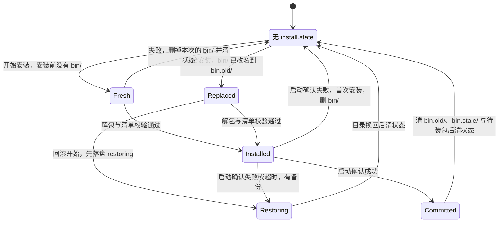
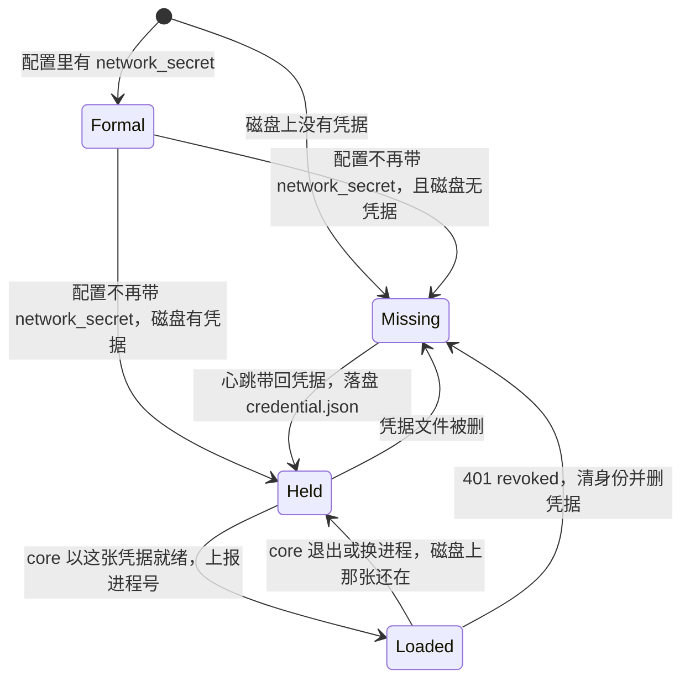
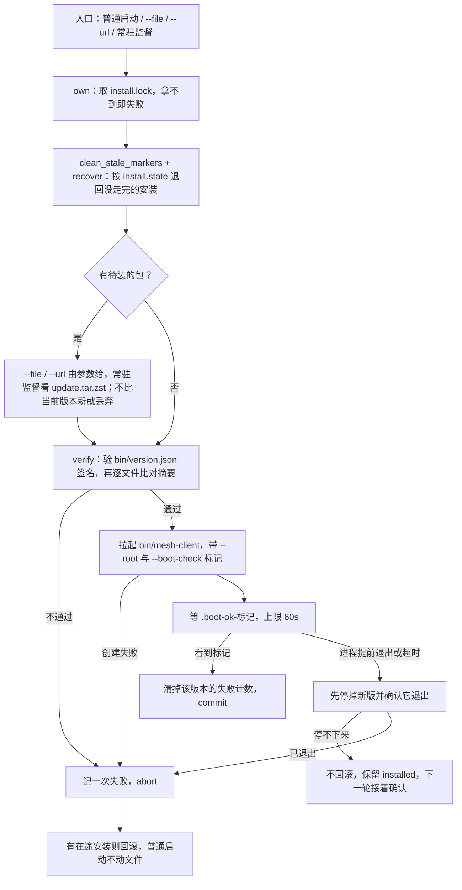
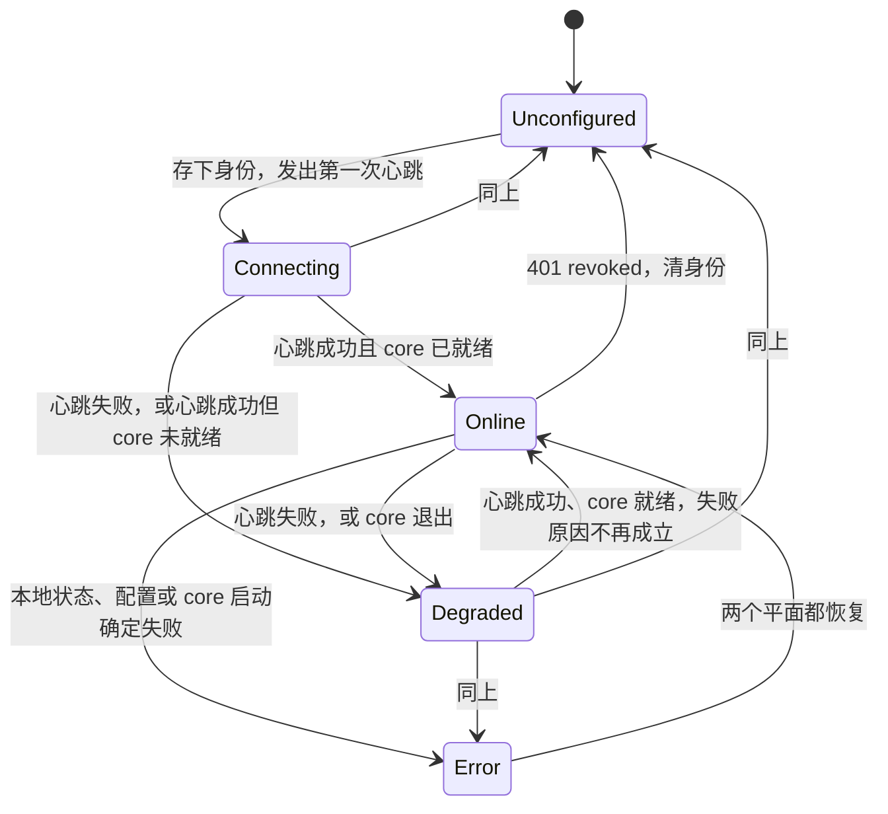
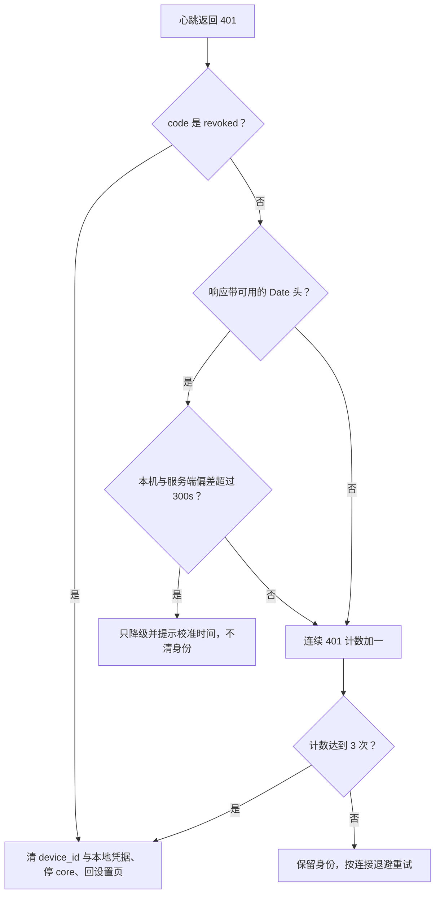

# 客户端状态模型

本文只写客户端的**状态空间**：有哪些状态、谁能进入、允许的迁移、跨状态必须成立的不变量。线格式与磁盘文件形状不在这里重复，见 [契约/updates.md](../../docs/contract/updates.md)（安装布局、回滚、槽位）与 [契约/client.md](../../docs/contract/client.md)（本地状态、启动、凭据上报、401）。

不覆盖：引擎事件循环的期限模型、更新模型（offer / 下载任务 / 工件状态 / 安装意图）。第 4 节的 `Status` 只写推导顺序，不写它在事件循环里于何处被写。流程图与时序见 [flows.md](flows.md)。

## 1. 安装事务

一次安装是一个事务，事务状态记在 `<安装根>/install.state`，取值是 `fresh`、`replaced`、`installed`、`restoring`、`committed`；**没有这个文件就等于没有在途的安装**。这个文件只由启动器读写，客户端与它的交接走 `update.tar.zst` 与 `.update-failures.json`。

| 状态 | 谁写它 | `bin/` 是什么 | 恢复到这一状态时做什么 |
| --- | --- | --- | --- |
| 无该文件 | `commit`、回滚收尾 | 已确认能启动的那一份 | 清掉 `bin.old/`、`bin.stale/` 残留，不碰 `bin/` 与待装包 |
| `fresh` | 安装开始（安装前无 `bin/`） | 本次解出来的，可能只解了一半 | 删掉 `bin/`，回到「没装过」 |
| `replaced` | 安装开始（有 `bin/`，已改名到 `bin.old/`） | 本次解出来的，可能只解了一半 | 删掉 `bin/`，把 `bin.old/` 改回来 |
| `installed` | 解包与校验通过 | 完整的新版本，未确认启动 | 保留，由这一轮启动去确认；确认失败再退 |
| `restoring` | 换回旧版本之前 | 正在被换出 | 接着换回，每一步可重复 |
| `committed` | 启动确认成功 | 已确认启动的新版本 | 不回滚，只清残留与状态文件 |

`bin.old/` 是上一个版本，只在一个安装窗口里存在：装之前把 `bin/` 改名到这里，确认成功就删掉，失败就改名回 `bin/`。`bin.stale/` 是回滚时被丢下的**新**版本：换回旧版本要先把新版本挪开，「改名」与「删除」不是一次操作，中间断掉时旧版本必须还在。两个目录都不承担判据——判据只有 `install.state`。

两把锁回答两个问题，互不替代：

| 锁文件 | 回答的问题 | 谁持有 |
| --- | --- | --- |
| `install.lock` | 谁在改安装根（`install.state`、`bin/`、`bin.old/`、`bin.stale/`、待装包） | 启动器覆盖整个事务；客户端只在提交更新包、替换启动器的那一段 |
| `instance.lock` | 这份 `config/` 是不是正被一个客户端使用 | 客户端进程从启动到退出 |

两者都是操作系统的文件锁，进程退出（含被杀）即释放，不留下需要人工删除的文件。冲突不靠 `install.lock` 预防：客户端在跑时手工安装由 `client_running` 判据拒绝。

不变量：

1. 判据唯一：`install.state` 决定「这次安装走到哪一步」，`bin.old/` 是否存在只说明有备份。
2. 先落盘再动手：`fresh`/`replaced` 写在改动 `bin/` 之前，`restoring` 写在换回目录之前，`committed` 写在清理之前。
3. 旧版本在任何一刻都不被删除：回滚顺序是 `bin/` → `bin.stale/`、`bin.old/` → `bin/`、最后删 `bin.stale/`。
4. 认不出的状态值按错误停机，不猜：猜一个状态只会拿错的前提去删文件。
5. 安装包只由安装事务删除：它是「请安装」的信号，普通启动确认只清 `bin.old/` 与 `bin.stale/`。
6. 每次安装先 `abort` 上一份没确认启动的事务：唯一的回滚材料不能被一次新安装覆盖。
7. 提交之后不回滚：清理失败只影响残留，`bin/` 的含义不再改变。

依据：`client/crates/launcher/src/install.rs` 的 `Tx`、`Owner::recover`、`Owner::abort`、`Owner::commit`、`Owner::undo`、`Owner::install_signed_by`、`client_running`；`client/crates/install/src/layout.rs` 的 `INSTALL_STATE`、`BIN_OLD`、`BIN_STALE`、`UPDATE_FILE`、`LOCK`、`INSTALL_LOCK`；`client/crates/install/src/lock.rs` 的 `Lock::path`、`Lock::owner_path`。

## 2. 凭据身份四态

「磁盘上有私钥」与「core 已经加载并确认它」是两件事，分成两个状态表达。控制面把上报的 id 当作「设备正在用这张」的证据，只有 core 确认加载过的那张才能上报。

| 状态 | 判定来源 | 心跳上报的 `credentialId` | 进入条件 |
| --- | --- | --- | --- |
| `Formal` | 配置里有非空 `network_secret` | 空串 | 配置判出正式节点，优先于磁盘上是否存着凭据 |
| `Missing` | 磁盘上没有可读的凭据 | `none` | 从未签发、文件被删、身份被清 |
| `Held(id)` | 磁盘上有凭据，但 core 未确认加载 | 空串 | 凭据刚落盘；core 未起、起不来、已退出或正在重启 |
| `Loaded(id)` | core 的期望规格里带着这张凭据，且进程已就绪 | 该 id | core 报告 `Started`（进程号非零） |

落盘到上报之间必须隔一次 core 重启：core 不支持热更新身份，换凭据只能换进程。提前上报刚写盘的那张，会让控制面撤销 core 仍在使用的旧凭据。空串对控制面是「既不确认也不签发」，恰好覆盖「正式节点」与「拿到了但还没加载」两种情形。

不变量：

1. 上报值只有三种形状：空串、`none`、磁盘上真实存在且 core 已加载的 id。
2. `Loaded(id)` 的 id 必然等于磁盘上那张凭据的 id：启动时按 id 比对，不一致按「没有凭据」处理，不带着别的凭据启动。
3. `Held` 永不上报 id，`Formal` 永不上报 `none`：前者会提前撤销在用的旧凭据，后者会让控制面每轮白签一张。
4. 正式节点即使磁盘上留着凭据也不改写认证方式，凭据对它不生效。
5. 凭据状态不缓存，每次上报现取磁盘事实与 core 事实。

依据：`client/crates/engine/src/sync.rs` 的 `CredentialState`、`CredentialState::reported_id`、`Engine::credential_state`、`Engine::save_credential`；`client/crates/engine/src/run.rs` 的 `AuthMode`、`CoreRun`、`Engine::on_core_event`、`Engine::start_core`、`NO_CREDENTIAL_ID`。

## 3. 启动器监督与启动确认

启动器只做一件事：把 `bin/` 里这一份拉到确定的结局，即验证、拉起、等确认、提交或回滚。四个入口（安装之后、普通启动、确认被打断后的下一次启动、Linux 常驻监督）走同一条 `boot_and_settle`，两个平台只差进程怎么托管。

| 结局 | 状态文件 | `bin/` 的去向 |
| --- | --- | --- |
| 校验不通过 | 记一次失败后 `abort` | 有在途安装才回滚；普通启动保持原样 |
| 进程创建失败 | 同上 | 同上 |
| 确认超时或提前退出 | 停掉新版、记一次失败、`abort` | 回到安装前的那一套 |
| 停不掉新版 | 保留 `installed` | 不改目录，下一次启动接着确认 |
| 确认成功 | 清失败计数、`commit` | 新版本定稿，清理备份与待装包 |

启动确认标记是 `<安装根>/.boot-ok-<token>`，token 由启动器每次生成；客户端在引擎、面板（桌面形态还含托盘）就位时写一次，不等网络。旧标记在每次事务入口统一清掉，上一次启动的标记不会被这一次误认。

| 项 | 常量 | 值 |
| --- | --- | --- |
| 等旧客户端退出 | `WAIT_CLIENT` | 60s |
| 等启动确认 | `WAIT_BOOT` | 60s |
| 停客户端后确认退出的等待 | `STOP_TIMEOUT` | 10s（Linux 先 SIGTERM，不退再强杀，各自等一次） |
| 包字节上限（`--url` 下载） | `PACKAGE_BYTES` | 200 MiB |
| 下载总时限 | `DOWNLOAD_DEADLINE` | 300s |
| 包内条目数 | `Budget::package().entries` | 1024 |
| 包根清单字节 | `Budget::package().manifest` | 64 KiB |
| 解包后总字节 | `Budget::package().unpacked` | 256 MiB |
| 读清单与解包时限 | `Budget::package().deadline` | 120s |
| 同一版本连续失败上限 | `LIMIT` | 2 次 |
| 失败记录保留版本数 | `KEEP_VERSIONS` | 5 个 |

不变量：

1. 安装根只有一个写者：拿不到 `install.lock` 就一行都不写，第二个启动器当场失败而不是并行改目录。
2. 确认只认本次的标记：token 每次不同，旧的标记不会被认领。
3. 确认成功之后 `bin/` 不再回滚；确认失败必须先把新版停掉并确认它退出，才允许改目录。
4. 普通启动失败不删任何文件；只有本次安装还没确认启动时才有东西可退。
5. `recover` 在拉起任何进程之前执行，每一轮都做（常驻启动器把它放在循环内）。
6. 等待客户端的那段时间不持安装根写权：客户端提交更新包要拿同一把锁。
7. 待装包只有消耗它的安装事务能删：删早一次，Linux 上的自动更新就永远装不上。

依据：`client/crates/launcher/src/install.rs` 的 `Owner::boot_and_settle`、`Owner::recover`、`Owner::abort`、`Owner::commit`、`wait_boot`、`clean_stale_markers`、`Budget`、`boot_or_restore`、`launch_installed`、`client_running`；`client/crates/launcher/src/launch.rs` 的 `Client::stop`、`STOP_TIMEOUT`；`client/crates/launcher/src/supervisor.rs` 的 `run`、`apply_pending`；`client/crates/install/src/failures.rs` 的 `Failures`、`LIMIT`、`KEEP_VERSIONS`；`client/crates/client/src/boot_check.rs` 的 `write_marker`；`client/crates/client/src/main.rs` 的 `boot_ready`。

## 4. 连接与降级

`Status` 是面向界面的连接状态，只由 `Engine::status` 从故障、身份、失败计数与 core 是否就绪推导，处理器不直接写它。控制面不可达只降级，不牵连数据面；core 不在跑也不中止心跳。

| 顺序 | 判据 | 结果 |
| --- | --- | --- |
| 1 | `fault` 非空（本地状态读不出、配置写不进、core 起不来） | `error` |
| 2 | 身份为空 | `unconfigured` |
| 3 | 连续失败计数大于 0 | `degraded` |
| 4 | 还没有过成功心跳 | `connecting` |
| 5 | core 已就绪 | `online` |
| 6 | 其余（心跳通过但 core 未就绪） | `degraded` |

心跳失败的处理分两支。非 401 失败按连接退避排下一次；401 按身份是否还可信决定降级还是清身份。

| 项 | 常量 | 值 |
| --- | --- | --- |
| 心跳间隔 | `HEARTBEAT_INTERVAL` | 30s |
| 单次心跳超时 | `HEARTBEAT_TIMEOUT` | 20s |
| 连接退避 | `connect_backoff`、`CONNECT_BACKOFF_MAX` | 10s 起，每次 ×1.5，上限 60s |
| core 重拉退避 | `revive_backoff`、`REVIVE_BACKOFF_MAX` | 1s 起，每次 ×2，上限 30s |
| core 短命判定 | `CORE_MIN_LIFETIME` | 5s；活够这么久才把重拉档位放回第一档 |
| 停 core 等回复 | `STOP_REPLY_TIMEOUT` | 15s |
| 时钟偏差窗 | `CLOCK_SKEW_LIMIT_SECONDS` | 300s |
| 连续 401 上限 | `AUTH_FAIL_LIMIT` | 3 次 |
| 本地状态读失败的重试间隔 | `LOCAL_STATE_RETRY` | 5s |

不变量：

1. 心跳在途时没有下一次期限：`due` 为空，因此不会出现两条并发心跳。
2. 旧代次的结果一律丢弃：重连或换身份之后的迟到响应不许改状态、不许落盘配置与凭据、不许按旧连接的 401 清身份。
3. 一次成功心跳同时清零连续失败计数与 401 计数，并记下最近心跳时刻。
4. 401 只有三种结局：清身份（`revoked`，或时间无明显偏差且连续 3 次）、只降级（偏差超窗）、继续重试。
5. 时钟偏差从不清身份：一次对时错误不该换来一次换机重注册。
6. core 未就绪不影响心跳继续；心跳通了而 core 没跑，按当前规格补启动。

依据：`client/crates/engine/src/run.rs` 的 `Status`、`Engine::status`、`Control`、`Engine::beat`、`Engine::on_heartbeat`、`connect_backoff`、`revive_backoff`、`CORE_MIN_LIFETIME`、`STOP_REPLY_TIMEOUT`、`Engine::settle`；`client/crates/engine/src/sync.rs` 的 `Engine::handle_auth_rejected`、`CLOCK_SKEW_LIMIT_SECONDS`、`AUTH_FAIL_LIMIT`。
