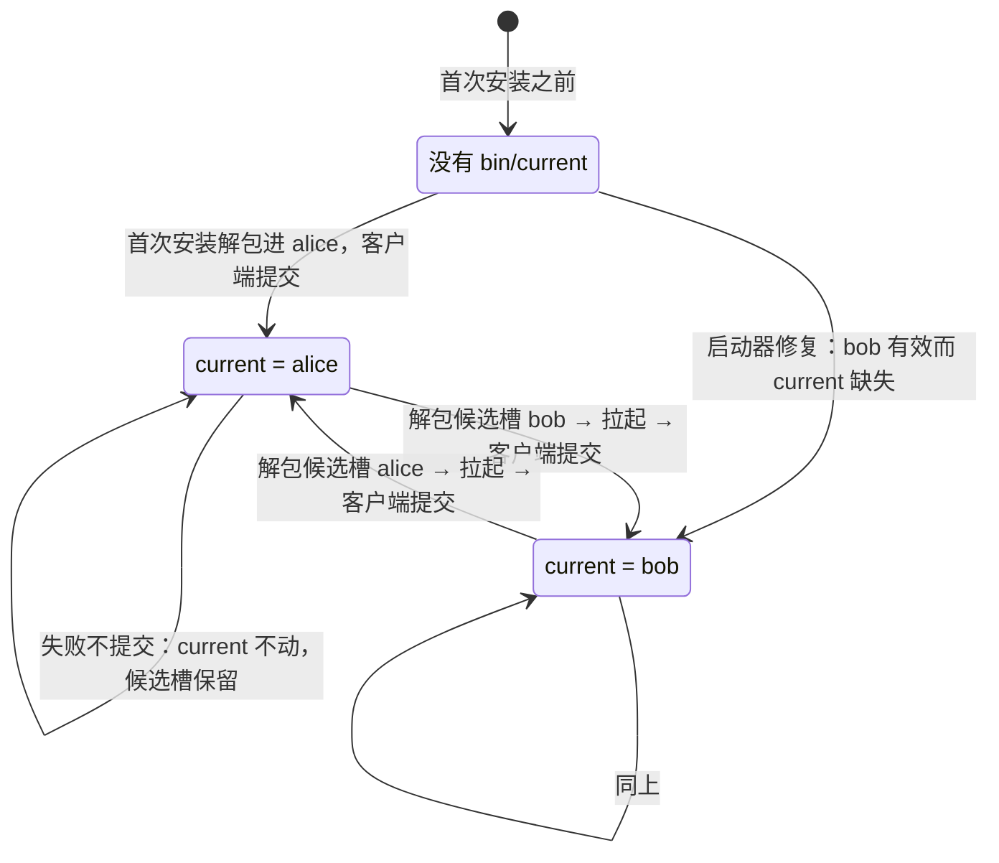
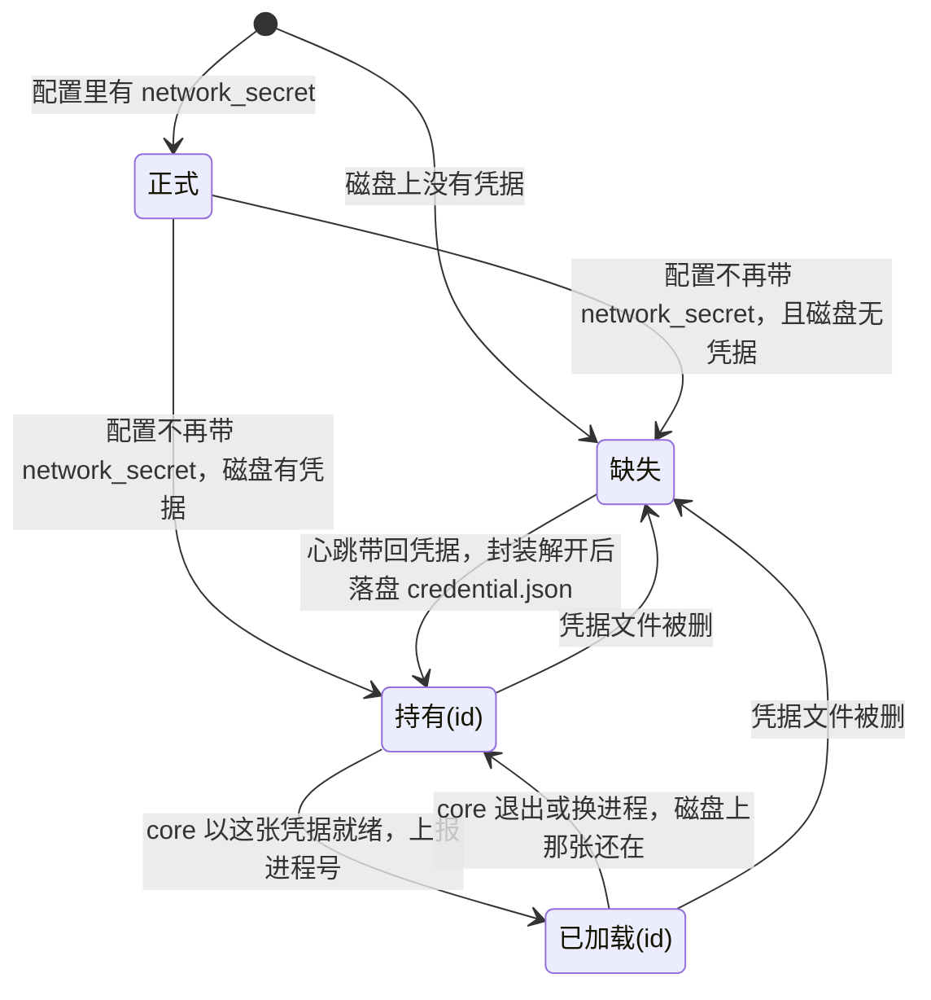
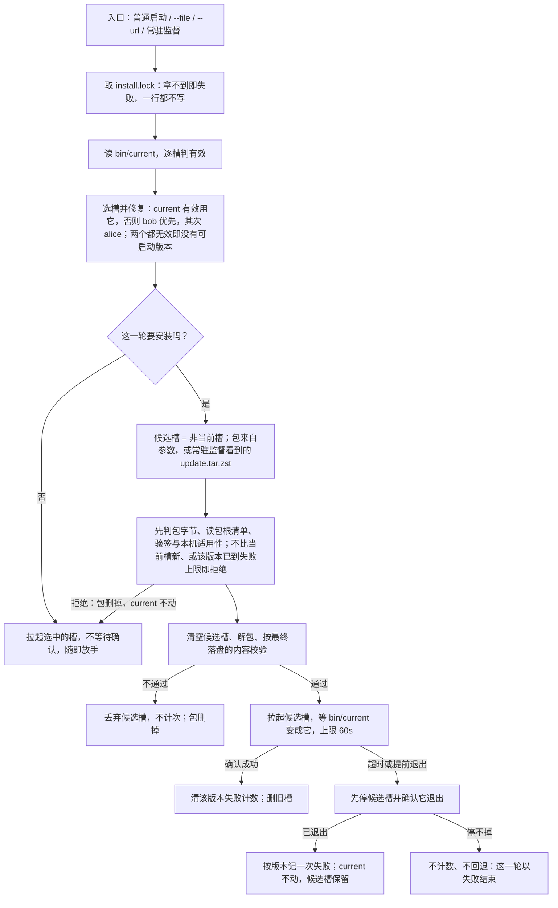
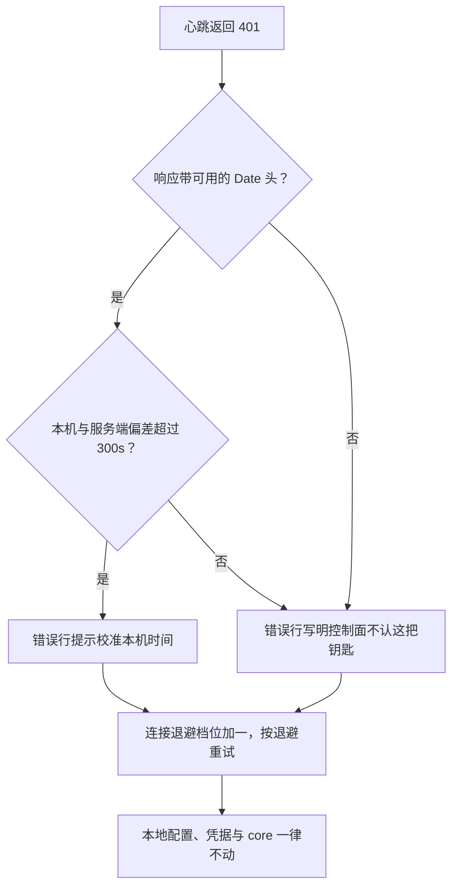
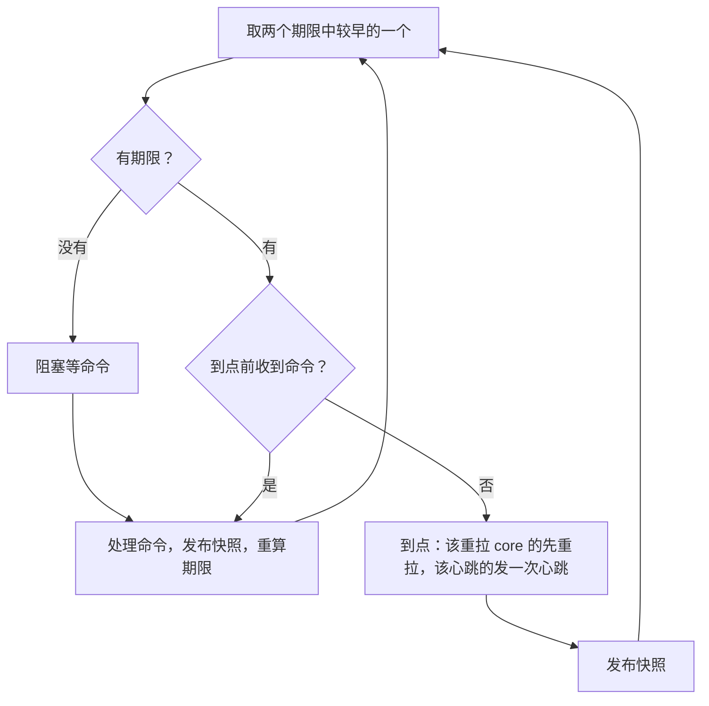
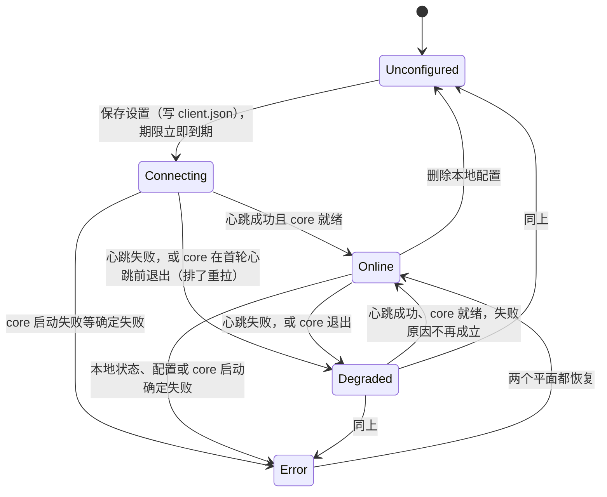
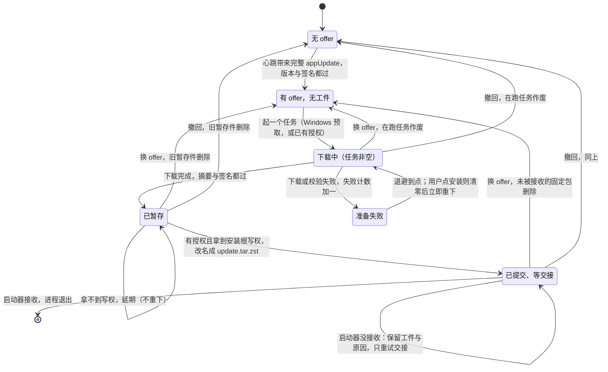
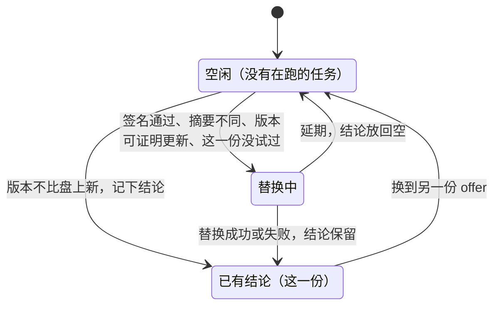

# 客户端状态模型

本文只写客户端的**状态空间**：有哪些状态、谁能进入、允许的迁移、跨状态必须成立的不变量。线格式与磁盘文件形状不在这里重复，见 [契约/updates.md](../../docs/contract/updates.md)（安装布局、槽位与提交）与 [契约/client.md](../../docs/contract/client.md)（本地状态、启动、凭据上报、401）。

本文覆盖六个模型：安装布局与当前槽、凭据身份、启动器的选槽与启动确认、连接失败与 401、引擎的期限模型与状态推导、更新（发布 / 下载任务 / 工件 / 授权）与启动器替换。不覆盖：线格式与磁盘文件字段（见上述契约），以及面板与托盘的呈现细节。流程图与时序见 [flows.md](flows.md)。

## 1. 安装布局与当前槽

当前槽只有一个指针：`bin/current` 一行，指向 `alice` 或 `bob`，或者不存在。「不存在」是合法状态，只表示还没有提交过；某个槽装得完不完整，由该槽自己的 `version.json` 回答。

| 状态 | 什么使它成立 | 谁写 |
| --- | --- | --- |
| 没有该文件 | 还没有提交过；手工删掉也不视为损坏 | — |
| `alice` | `alice` 是有效槽，且被提交 | 客户端（启动成功后按自身所在目录名）；启动器只在修复时 |
| `bob` | 同上 | 同上 |

规则：

1. `bin/current` 是唯一的持久安装状态：一行文本，值只能是两个槽名之一，首尾空白忽略；读不出、或读到的不是这两个值，都按「没有这个文件」处理。
2. 槽名固定为 `alice`、`bob`，永不含版本号：Windows 的防火墙与杀软规则按程序路径建立，路径集合必须恒定。
3. 槽有效：`version.json` 验签通过（`MESH4`、`slot = client`、本机平台、文件集合与逐文件摘要），清单里必须列出主程序与内核，且目录里没有清单之外的文件。没有有效清单即半包。
4. 候选槽 = 非当前槽，不需要任何记录。手动安装先按「修复」判出当前槽（若可能），目标取当前槽之外的另一个；两个槽都无效、连当前槽都判不出来时，目标固定为 `alice`，与首次安装一致，并删掉遗留的 `current`。开装之前再判一条不变量：`current` 不得已经等于本次候选槽——撞上就拒绝安装，不猜。
5. 提交权归客户端。提交时点就是启动就绪的时点：引擎与面板就位后提交，桌面版还要求托盘真的立起来（更新已提交而进程随即退出时，下一轮登录同样失败），headless 在面板起来之后提交。客户端取自身可执行文件的父目录名，按 ASCII 小写比较，只认 `alice` / `bob`；原子写（临时文件 + 改名），幂等。父目录不是槽名（例如从别处手工运行）就什么都不做。
6. 启动器从不提交，只在 `current` 缺失、值非法、或指向的槽无效时补写一次；那是修复，不是提交。修复写失败即这一次流程失败：启动确认的前提正是「拉起之前 `current` 不等于该槽」，指针修不出来时那次观察没有意义。
7. 选槽顺序：`current` 有效就用它；否则在有效槽里取名字字典序最大的（`bob` 优先于 `alice`）；若那个槽无效则取另一个；两个都无效即没有可启动版本（首次安装或需要人工），并删掉遗留的 `current`。依据是名字的字典序，不是目录时间，也不是清单里的版本号——这一刻的诉求是确定性、不需要解包；选错也能从日志看出选了谁。
8. 启动确认只属于安装：拉起候选槽之后，`current` 变成正在跑的那个槽即为成功；60 秒内没变或子进程退出即为失败。普通启动不做这个观察——`current` 本来就指着那个槽，确认恒为真，成败只看进程有没有创建出来。
9. 失败时不改 `current`、不删候选槽。候选启动的结局按三种形状收尾：进程没创建出来、确认失败且已确认候选退出，都按版本计次；确认失败但停不掉候选时不计数、也不回退到旧槽——那个进程可能还活着，计数与回退都会把它当成没在跑。同一版本连续失败到上限就跳过它：「起不来」不一定是版本的问题（网络、凭据过期、TUN 冲突、UAC 没点同意），计数必须按版本记，不能按槽记。候选槽的 `version.json` 读不出或验不过时另走一条：丢弃候选槽、删掉数据根里的待装包、记一条日志，不计次。
10. 清理时机只有一处：确认成功之后删旧槽（此刻 `current` 已指向新槽）。选槽时不删任何槽：启动器分不清「上一次提交留下的旧槽」与「这一次刚装好、还没确认的候选槽」，按「另一个槽有效就删」会抹掉刚失败的那次安装。不在确认成功那一瞬删：那一刻客户端刚写完 `current`，删东西只会制造竞态；客户端可能晚于 60 秒才写 `current`，启动器若在确认过程中先删候选，就会出现 `current` 指向一个不存在的槽——Windows 上运行中的程序删不掉、Linux 上能 unlink，这个平台差异会把竞态变成只在 Linux 上出现的砖。

两把锁回答两个问题，互不替代：

| 锁文件 | 回答的问题 | 谁持有 |
| --- | --- | --- |
| `install.lock` | 谁在改安装根（槽目录、修复 `current`） | 启动器覆盖「解包到候选槽 → 拉起 → 等确认」；客户端只在提交更新包、替换启动器的那一段 |
| `instance.lock` | 这份 `config/` 是不是正被一个客户端使用 | 客户端进程从启动到退出 |

两者都是操作系统的文件锁，进程退出（含被杀）即释放，不留下需要人工删除的文件。`bin/current` 的提交不取 `install.lock`：启动器等确认时正持有它，提交若也要拿锁就永远提交不了。两个写者也不会并发——启动器的修复写在「拿到 `install.lock`、拉起客户端之前」，客户端的提交写在自己启动成功之后，前者结束时后者才可能开始。冲突不靠 `install.lock` 预防：客户端在跑时手工安装一律拒绝，除非显式等它退出（`--wait-for`）。

不变量：

1. 判据分两层：`bin/current` 指向哪个槽，槽是否可用由该槽的 `version.json` 回答；没有 `current` 不是错误。
2. 半包不靠状态表达：候选槽没有有效 `version.json` 就是没装好。
3. 提交与修复分离：只有客户端提交；启动器只在缺失、非法或无效时修复一次。
4. 启动确认只认 `current` 变成正在跑的槽，不认别的信号；普通启动不做确认。
5. 失败不改 `current`、不删候选槽；计数按版本，不按槽。
6. 清理只在确认成功之后发生，删的是旧槽；选槽不删任何槽。

## 2. 凭据身份四态

「磁盘上有私钥」与「core 已经加载并确认它」是两件事，分成两个状态表达。控制面把上报的 id 当作「设备正在用这张」的证据，只有 core 确认加载过的那张才能上报。

| 状态 | 判定来源 | 心跳上报的 `credentialId` | 进入条件 |
| --- | --- | --- | --- |
| 正式 | 配置里有非空 `network_secret` | 空串 | 配置判出正式节点，优先于磁盘上是否存着凭据 |
| 缺失 | 磁盘上没有可读的凭据 | `none` | 从未签发、文件被删、删除了本地配置 |
| 持有(id) | 磁盘上有凭据，但 core 未确认加载 | 空串 | 凭据刚落盘；core 未起、起不来、已退出或正在重启 |
| 已加载(id) | core 已就绪，且它实际应用的规格里带着这张凭据 | 该 id | core 报告就绪 |

落盘到上报之间必须隔一次 core 重启：core 不支持热更新身份，换凭据只能换进程。提前上报刚写盘的那张，会让控制面撤销 core 仍在使用的旧凭据。空串对控制面是「既不确认也不签发」，恰好覆盖「正式节点」与「拿到了但还没加载」两种情形。

不变量：

1. 上报值只有三种形状：空串、`none`、磁盘上真实存在且 core 已加载的 id。
2. `已加载` 的 id 取自运行中 core 实际应用的规格；启动时按 id 与磁盘比对，不一致按「没有凭据」处理，不带着别的凭据启动。
3. `持有` 永不上报 id，`正式` 永不上报 `none`：前者会提前撤销在用的旧凭据，后者会让控制面每轮白签一张。
4. 正式节点即使磁盘上留着凭据也不改写认证方式，凭据对它不生效。
5. 凭据状态不缓存，每次上报现取磁盘事实与 core 事实。

## 3. 启动器：选槽、拉起与启动确认

启动器只有两个结局：把选中的槽拉起来（普通启动），或把候选槽拉起来并等它提交（安装）。清理、选槽、修复 `current` 对两类结局是同一条路径，每一轮都做；两个平台只差进程怎么托管——Windows 的启动器拉起后放手，Linux 的启动器是 systemd 的 `ExecStart`，拉起后一直守着客户端。

规则：

1. 安装顺序固定：先判包本身（字节上限、包根清单、签名、槽位与平台、是否比当前槽新、失败次数是否已满），再动候选槽。动过候选槽之后的失败只丢弃候选槽、不计次——坏包不该把一个版本号钉死。
2. `--force` 跳过「不比当前新」与「失败次数已满」两条判据，只给手动修机器用。
3. 确认成功：清该版本的失败计数，再删旧槽。旧槽此刻既不是在跑的那一份，也不是回滚材料。
4. 确认失败：先停候选槽并确认它退出；停得掉才按版本计次。停不掉就保留进程事实，不回退、不宣告完成——它可能还占着 `instance.lock` 与 TUN。
5. Windows 装完即退，失败后要自己把当前槽拉回来（客户端已经退出，没有别人替它起）。Linux 的常驻启动器回到循环开头重走一遍；手动安装那一次拉起只为确认能跑，确认之后把临时客户端停掉，交给 systemd 接管，停不掉就不报完成。
6. 普通启动失败不删任何文件，按实际错误退出（Linux 上交给 systemd 的重启策略）。
7. `update.tar.zst` 只由消耗它的安装事务删：读到就不再需要，成功与失败都删，摘要同生命周期。`--file` 指向别处时那是用户文件，成功失败都不动。

| 结局 | 处理 | `bin/current` 与槽 |
| --- | --- | --- |
| 包不可用（超限、清单读不出、验签不过、不比当前新、失败次数已满） | 拒绝安装，候选槽未动 | 不变 |
| 解包或落盘后校验不过 | 丢弃候选槽，不计次 | 不变 |
| 进程创建失败 | 按版本计次 | 不变 |
| 确认超时或提前退出 | 先停候选槽；停得掉才计次 | 不变 |
| 停不掉候选槽 | 不动文件、不计数、不回退 | 不变，下一轮接着判 |
| 确认成功 | 清该版本计数；删旧槽 | 已由客户端写成该槽 |

启动确认没有独立标记：客户端在引擎、面板（桌面形态还含托盘）就位时原子写 `bin/current`，启动器只观察这个文件。写失败只影响这一次提交，`current` 保持旧值，下一轮按选槽判据重试。

| 项 | 值 |
| --- | --- |
| 等旧客户端退出 | 60s |
| 等启动确认 | 60s |
| 停客户端后确认退出的等待 | 10s（Linux 先 SIGTERM，不退再强杀，两步各等一次；Windows 只有强制结束） |
| 包字节上限（`--url` 下载与安装共用） | 200 MiB |
| 下载总时限 | 300s |
| 包内条目数 | 1024 |
| 包根清单字节 | 64 KiB |
| 解压窗口 | 64 MiB |
| 解包后总字节 | 256 MiB |
| 读清单与解包时限（同一个截止时刻） | 120s |
| 同一版本连续失败上限 | 2 次 |
| 失败记录保留的版本数 | 5 个（按版本号最大者留） |

不变量：

1. 安装根只有一个写者：拿不到 `install.lock` 就一行都不写（`current` 的提交除外），第二个启动器当场失败而不是并行改目录。
2. 确认只认 `bin/current` 变成正在跑的槽：60 秒内没变或子进程退出即为失败；普通启动不做这个观察。
3. 确认成功之后 `current` 不再回退；确认失败必须先把正在跑的那一份停掉并确认它退出。
4. 普通启动失败不删任何文件；失败路径不删候选槽。
5. 选槽在拉起任何进程之前执行，每一轮都做（常驻启动器把它放在循环内）。
6. 等待客户端运行的那段时间不持安装根写权：客户端提交更新包要拿同一把锁。
7. 待装包只有消耗它的安装事务能删：删早一次，Linux 上的自动更新就永远装不上。

## 4. 连接失败与 401

心跳的结果只有三类：成功、非 401 失败、401。每一类只改两件事——连接退避的档位与下一次期限；401 **不改任何本地状态**。控制面不可达只降级，不牵连数据面；core 不在跑也不中止心跳。

| 结果 | 连接退避档位 | 下一次期限 | 本地状态 |
| --- | --- | --- | --- |
| 成功 | 归零，记下最近心跳时刻 | 30s 后例行 | 按响应更新配置、凭据与 offer |
| 非 401 失败（网络、超时、5xx、取样失败） | 加一 | 连接退避 | 不变 |
| 401，时钟偏差超过 300s | 加一 | 连接退避 | 不变；错误行提示校准本机时间 |
| 401，其余 | 加一 | 连接退避 | 不变；错误行写明控制面不认这把钥匙 |

| 项 | 值 |
| --- | --- |
| 单次心跳超时 | 20s |
| 时钟偏差窗 | 300s |

不变量：

1. 401 不区分原因：服务端对所有认证失败一律回 `unauthorized`，客户端只能从 `Date` 头读出时间偏差。
2. 401 不改本地状态：没有可清的身份，也没有「连续几次就失效」的计数；恢复只靠控制面接受这把公钥之后的下一次成功心跳。
3. 退避与 core 重拉各自持有期限：控制面持续不可达只让心跳退避，不会让 core 的重拉停下来。
4. core 未就绪不影响心跳继续：心跳通了而 core 没跑，按当前规格补启动。

## 5. 期限模型与状态推导

引擎只有一个线程读写状态，一条循环等两件到期的事：下一次联系控制面、下一次重拉 core。两者独立推进，每次唤醒取最早的一个；没有期限时阻塞等命令。

| 期限 | 何时设置 | 值 |
| --- | --- | --- |
| 下一次心跳 | 心跳成功 | 30s |
| | 非 401 失败、401 | 连接退避：10s 起每次 ×1.5，60s 封顶 |
| | 本地身份读失败 | 5s |
| | 保存设置、手动重连 | 立即 |
| | 请求在途 | 无：不排下一次 |
| | 没有本地配置 | 无 |
| 下一次重拉 core | core 启动失败、core 自行退出 | 固定 30s 之后 |
| | core 报告就绪，且活过 60s | 清空 |
| | 一轮 10 次用完 | 挂起 10 分钟；到点自动开新一轮并使故障行失效 |
| | 手动重连 | 立即，次数归零 |

代次把「结果属于哪一次」钉死，三种代次都只增不减：

- 心跳代次：每发一次加一，结果只接受当前代次；重连与换控制面也加一，让在途结果作废。
- core 代次：每启动一代分配一个新值，core 事件与 STUN 结果按它匹配，迟到事件丢弃。
- 任务代次：只增不减，换 offer 不重置；下载与启动器替换的完成消息按「任务相等」与「当前 offer 的版本与摘要相等」两条判据决定还算不算数。

界面状态没有写入点：由有没有确定失败、有没有本地配置、有没有心跳结果、core 是否就绪一次算出。

| 顺序 | 判据 | 结果 |
| --- | --- | --- |
| 1 | 有确定失败：本地状态读不出、配置写不进、core 起不来 | `error` |
| 2 | 没有本地配置：没有 `client.json` | `unconfigured` |
| 3 | 没有心跳结果、连接退避档位为 0、没有排定的重拉 | `connecting` |
| 4 | 连接退避档位为 0、有过心跳结果、core 已就绪 | `online` |
| 5 | 其余：两个平面有一个没就绪 | `degraded` |

不变量：

1. 期限只在引擎线程写；心跳、下载、面板、STUN 线程只投递结果。
2. 两边期限独立：控制面不可达只让心跳退避，不会取消 core 的重拉期限。
3. 请求在途时下一次心跳为空，因此同一时刻最多一条心跳。
4. 到点才推进：两边都再查一次自己的期限是否已过。
5. 旧代次的结果一律丢弃，不许落盘配置或凭据，也不许按旧连接的 401 改状态。
6. 没有本地配置时控制面没有期限；若也没有排定的重拉，循环退化为纯等命令。
7. 界面状态是推导值，任何处理器都不写它；失败原因只在两个平面都恢复之后统一清掉，状态随下一次推导改变。

## 6. 更新模型

自更新把四个事实与一个计数器分开表达，每个只有一个落点；面板上的 `updateState`（空串 / `downloading` / `ready` / `error`）是它们的投影，不是另一份状态。服务端每轮心跳都带完整的一份 `appUpdate`；「是不是同一份」由客户端按版本与摘要判断，与响应形状、下载进度都无关。线格式与交接约定见 [契约/updates.md](../../docs/contract/updates.md)「客户端如何装」。

| 轴 | 取值 | 谁改它 |
| --- | --- | --- |
| 手上的发布 | 没有；有（版本、摘要、地址、说明、自动策略、是否已自动试过） | 心跳带来新的一份、同一份或撤回 |
| 下载任务 | 没有；在跑（代次、版本、摘要） | 需要字节时起一个；完成消息回来时落下 |
| 工件 | 无；已暂存（`.part` 的路径）；已提交（最近一次交接未被接收的原因）；失败（原因、下一次重试时刻） | 下载完成、交接、起任务、撤回或换 offer |
| 失败计数 | 本份 offer 连续失败了几次 | 失败加一；手动重试与换 offer 归零 |
| 授权 | 没有；手动；自动 | 用户点安装、自动策略；offer 变化或交接完成时清空 |

| 当前 | 事件 | 迁移 | 落地动作 |
| --- | --- | --- | --- |
| 无 offer | 心跳带完整 `appUpdate`，版本与签名都过 | → 有 offer，授权与工件清空 | 删上一份暂存件（内容不再被授权）；Windows 立即预取，Linux 等授权 |
| 有 offer | 心跳带来同一份（版本与摘要都相同） | 不变 | 刷新地址、说明与自动策略；不重下、不动进度、失败计数不清零 |
| 有 offer | 心跳撤回（响应里没有 `appUpdate`） | → 无 offer | 删暂存件与被驳回的固定包、清授权与计数；在跑任务留着，回来时自弃 |
| 有 offer | 再次完整下发（换版本或同版本重发） | 旧 offer → 新 offer | 删旧暂存件与未被接收的固定包、清授权、失败计数归零；在跑任务留着 |
| 有 offer、无工件 | 策略允许且这一份没试过 | 记「自动」授权 | 无（每份只记一次） |
| 有 offer、无工件 | 没有授权，且平台是 Windows | 起任务 | 预取到 `.part`：只暂存，不算授权 |
| 有 offer、有授权 | 需要字节 | 起任务 | 写 `<root>/update.tar.zst.part`，同一时刻最多一个任务 |
| 下载中 | 任务完成、仍是当前 offer | → 已暂存 | 只暂存，不提交 |
| 下载中 | 完成时 offer 已换或已撤回 | → 新 offer，或 → 无 offer | 删掉这条任务自己的 `.part` |
| 下载中 | 失败、仍是当前 offer | → 失败 | 失败计数加一，下一次重试时刻按退避推后 |
| 失败 | 退避到点，下一轮心跳 | → 下载中 | 重下；累计 5 次后停手等人 |
| 已暂存 + 有授权 | 拿到安装根写权 | → 已提交 | 改名成 `<数据根>/update.tar.zst`；工件仍归引擎，等启动器接收 |
| 已暂存 + 有授权 | 拿不到写权 | 不变 | 只记日志，下一轮心跳再试，已校验的字节不重下 |
| 已暂存 + 有授权 | 启动器替换任务还在跑 | 不变 | 延期交接，避免两件事同时抢安装根 |
| 已提交 | 启动器接收 | 清空授权与工件，进程退出 | 安装事务从此拥有那份包 |
| 已提交 | 交接失败（启动器不在、创建失败） | 仍是已提交，带上失败原因 | 保留工件与授权、把「已自动试过」放回去，下一轮只重试交接，不重下 |
| 无 offer | 用户点安装 | 拒绝 | 无 |
| 失败 | 用户点安装 | → 下载中 | 清掉失败计数与退避，立即重下 |

启动器槽位单独维护，因为它不随客户端包 offer 重建：

| 字段 | 含义 | 何时变 |
| --- | --- | --- |
| 盘上摘要 | 盘上那份启动器的摘要 | 启动时读一次；替换成功后改成任务的摘要 |
| 盘上版本 | 盘上那份自报的版本号 | 同上；读不到时不判降级 |
| 已下结论的摘要 | 已经有结论的那一份 offer 摘要 | 开始替换或判定「不比现在新」时写入；延期时放回空 |
| 在跑的任务 | 在跑的替换任务 | 单飞判据：非空时不起第二个 |

摘要与盘上那份相同时直接返回，不记结论：每轮最多多算一次摘要。盘上版本号读不到时不判降级，放行这一次；延期是唯一会把结论放回的收尾，因此它不阻止下一轮重试。

不变量：

1. 五个轴互不代理：能否交接由「有授权」与「工件已就绪（已暂存或已提交）」同时成立表达；失败计数只是计数，不表达能否安装。
2. 任务单飞：任务非空时不新起下载——`.part` 只有一个，两个线程写只会互相截断。
3. 暂存不是信号：固定名 `update.tar.zst` 只在持安装根写权提交的那一刻出现，此前工件一直叫 `.part`。出现之后它的去留只剩两方：交接没被接收时引擎仍可撤回它（撤回或换 offer），交接被接收后由安装事务消费并删除。
4. 只有被授权的交接才提交：自动授权在交接前重新校验当前策略，策略已关就放弃；手动授权只看 offer 还在不在。
5. 锁争用只延期：拿不到写权时暂存件原样留着，下一轮心跳重试，已校验的字节不重下。
6. 结果按代次与 offer 双重判定：任务代次不等，或当前 offer 的版本与摘要变了，这条结果连文件都不留。
7. 授权随 offer 变化一起清空，因此它天然只指向当前 offer，不需要另存一份身份副本。
8. 失败计数住在 offer 上，起任务不清零：退避按次数翻倍、上限 10 分钟，累计 5 次后停手等人处理。只有手动重试与换 offer 归零。
9. 启动器替换同一份只试一次：延期是唯一会把结论放回的收尾。

| 项 | 值 |
| --- | --- |
| 包字节上限 | 200 MiB |
| 下载总时限 | 20 分钟 |
| 启动器下载总时限 | 10 分钟 |
| 自动重试次数上限 | 5 次 |
| 失败退避 | 30s 起每次 ×2，上限 10 分钟 |
| 启动器替换的临时目录 | `update/` |
